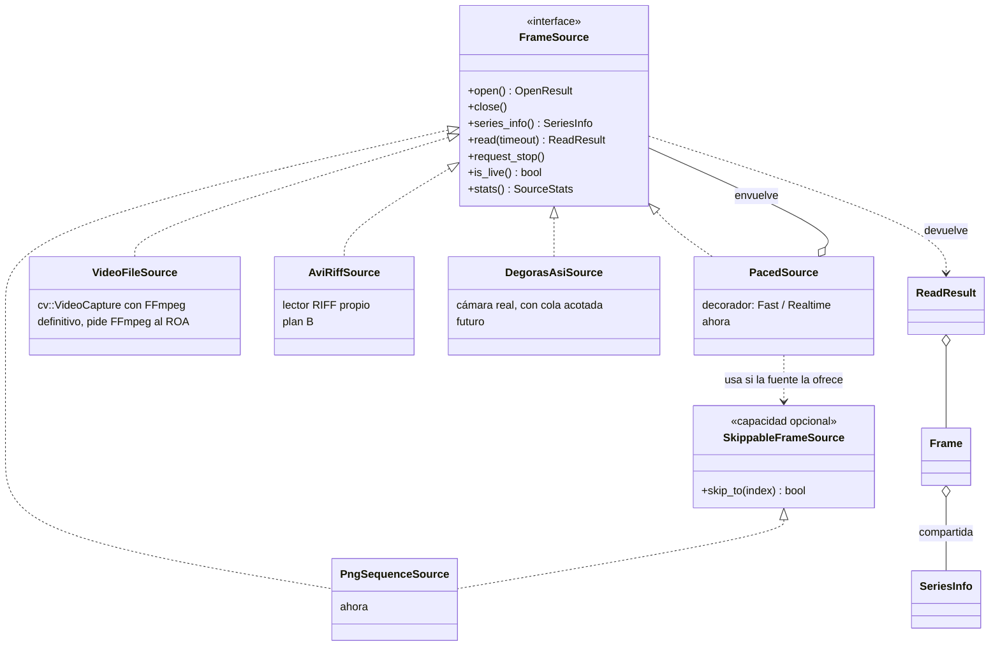
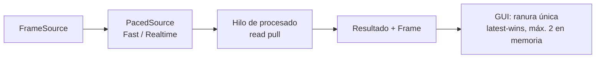

# Contrato de la interfaz de fuente de fotogramas (`frame_source`)

**Estado:** borrador para revisión, actualizado con la librería `dpot` (2026-11-23) · **Autor del diseño:** Juan (equipo de imagen y apuntado) · **Revisores:** Javi y Ramón
**Issue:** «Contrato de la interfaz de fuente de fotogramas» (`docs/plan-issues.md` §1), milestone *Fase 1 – Contratos*.
**Requisitos que cubre:** `docs/contexto_proyecto.md` §5 (Entrada: la arquitectura debe permitir DegorasASI) y §8.1.
**Revisión con `dpot` (2026-11-23):** la librería del ROA ya está en `libs/dpot/` (PR #6) y `docs/contexto_proyecto.md` §11 recoge sus hallazgos. Esta revisión adopta su `Frame`, `io::loadFrame` e `io::captureTime`, y corrige tres supuestos del borrador anterior: el `.txt` es **por fotograma** (no por serie), hay **hora por fotograma** (`frame_times.csv`) y el nombre del fichero **trunca** las décimas de minuto. 

## Cómo leer este documento

Cada decisión lleva una etiqueta:

- **[Decidido]**: lo ha decidido Juan de forma explícita.
- **SUPUESTO**: depende de algo no confirmado por el ROA o no comprobado en el entorno. Se resuelve con la pregunta o la prueba indicada.

Todo el pseudocódigo es C++20 sin implementación y no se ha compilado. Los nombres son provisionales.

---

## 1. Propósito y responsabilidades

`frame_source` entrega al resto del sistema una secuencia de fotogramas con su marca de tiempo y los metadatos de la cámara que los capturó, sin que el núcleo sepa de dónde vienen: una secuencia de PNG, un vídeo o, más adelante, la cámara real a través de DegorasASI (§5, §8.1).

**Responsabilidades de la fuente**

1. Describir la serie (`SeriesInfo`): solo lo que es **constante** en toda la serie (cámara, tamaño, recorte, volteo, formato de píxel, patrón del sensor) **[Decidido]**. Los ajustes de adquisición que cambian de un fotograma a otro (ganancia, exposición, temperatura, `black_level`) viajan en cada `Frame` **[Decidido]**.
2. Informar de la **fase del patrón Bayer** ya corregida por el origen del recorte **[Decidido]**.
3. Comunicar el fin de la fuente, los fotogramas ilegibles y los fallos **sin lanzar excepciones**.

**Lo que la fuente NO hace**

- No aplica debayer, volteo, recorte, reducción de resolución ni conversión de tipo **[Decidido]**. Eso es del preprocesado del núcleo.
- No conoce la geometría de la cámara (escala, giro, punto de referencia): eso es de `calibration`.
- No detecta saturación ni inestabilidad: informa del `white_level` y el núcleo decide.
- No controla la cámara (exposición, ganancia): solo lee **[Decidido]**; a confirmar con el ROA (pregunta 7).
- No gestiona la señal de montura en tránsito: es otro módulo (`mount_signal`, §5).

**Por qué no depende de Qt.** `libs/frame_source` solo usa la biblioteca estándar, OpenCV y la librería `dpot` del ROA (`libs/dpot`, capas `common` e `io`, sin Qt); Qt queda en `apps/gui`. Así la CLI y los tests usan la misma fuente que la GUI, y el código es portable a Linux.

---

## 2. Estructura del fotograma

### 2.1 Tipos auxiliares

```cpp
// Fase del mosaico en el píxel (0,0) de la imagen ENTREGADA, o Mono.
enum class PixelFormat { Mono, BayerRGGB, BayerGRBG, BayerGBRG, BayerBGGR };

enum class FlipMode { None, Horizontal, Vertical, Both };   // "Flip = Horizon" -> Horizontal

enum class TimeQuality {
    Measured,    // hora tomada de la cámara/driver por fotograma (futuro DegorasASI)
    Estimated,   // calculada: hora de escritura del fichero, inicio de sesión + periodo, nombre + periodo...
    Unknown      // no hay hora utilizable; solo hay índice
};

// De dónde sale la hora estimada (§2.3). Informativo [Decidido]; el núcleo se guía por quality y uncertainty.
enum class TimeBasis { SeriesStartEnd, FramesCsv, SessionFolder, FileName, None };

struct FrameTime {
    std::optional<std::chrono::system_clock::time_point> utc;   // vacío si quality == Unknown
    std::chrono::nanoseconds uncertainty{};                     // semiancho: la hora real está en utc ± uncertainty
    TimeQuality quality = TimeQuality::Unknown;
    TimeBasis basis = TimeBasis::None;
    std::optional<std::chrono::nanoseconds> since_series_start; // vacío si no hay periodo
};
```

### 2.2 `Frame`

```cpp
// Ajustes de adquisición DE ESTE fotograma, leídos de su `<nombre>.PNG.txt` [Decidido]. Cambian dentro de una serie.
struct AcquisitionSettings {
    double exposure_s;                        // segundos (el .txt trae milisegundos)
    double gain;                              // unidades de ASICap (no son dB)
    std::optional<double> sensor_temp_c;      // °C
    std::optional<int> black_level;           // de "Brightness"; unidades originales del sensor (raw); solo informativo
};

struct Frame {
    std::uint64_t index;                      // PNG: NNNN del fichero − primer NNNN de la serie (0, 1, 2...); un hueco en NNNN es un hueco en index
    dpot::common::Frame image;                // 1 canal, uint16; datos de 8 bits ×257; image.raw(x,y) da el valor original [Decidido]
    PixelFormat pixel_format;                 // Mono, o fase Bayer en (0,0) de `image`, ya corregida por el recorte
    int bits_per_sample;                      // bits válidos por muestra de la cámara (8 ahora)
    std::uint32_t white_level;                // saturación en unidades ORIGINALES del sensor (raw), no ×257 [Decidido]
    AcquisitionSettings acquisition;          // ajustes de este fotograma [Decidido]
    FrameTime time;
    std::shared_ptr<const SeriesInfo> series; // metadatos constantes de la serie, compartidos

    cv::Mat view() const noexcept;            // vista sobre image.px, sin copia, solo lectura [Decidido]; detalles en "Vista cv::Mat"
};
```

| Campo | Tipo | Unidad / significado | Etiqueta |
|---|---|---|---|
| `index` | `uint64_t` | Con secuencias PNG: `NNNN` del fichero menos el primer `NNNN` de la serie, desde 0 y monótono; los huecos de numeración se ven como huecos de `index`. En otras fuentes, posición en la serie. Los fotogramas perdidos conservan su índice. | [Decidido] (PNG); [Decidido] (otras fuentes) |
| `image` | `dpot::common::Frame` | 1 canal, `uint16`, filas de arriba abajo (la fila crece hacia −El, §2), píxel (0,0) = centro del píxel superior izquierdo (convención de `dpot`). Datos de 8 bits ×257 (255 → 65535); `bitDepth` guarda 8 o 16; `raw(x,y)` devuelve el original. Dimensiones = `series->width × height`. | [Decidido] |
| `pixel_format` | enum | Fase del patrón en el píxel (0,0) entregado. | [Decidido] (fase corregida) |
| `bits_per_sample` | `int` | Bits válidos de la cámara; 8 con RAW8. Siempre ≤ `image.bitDepth` (8 o 16). | [Decidido] (campo); relación con `bitDepth`: [DECIDIDO] |
| `white_level` | `uint32_t` | Valor a partir del cual un píxel está saturado, en **unidades originales del sensor**. **No se asume `2^bits − 1`**. Con RAW8, 255. | [Decidido] |
| `acquisition` | `AcquisitionSettings` | Ganancia, exposición, temperatura y `black_level` **de este fotograma**. | [Decidido] |
| `time` | `FrameTime` | Ver §2.3. | [Decidido] (calidad e incertidumbre viajan con el dato) |
| `series` | `shared_ptr<const SeriesInfo>` | Un solo objeto por serie, compartido; solo lo constante (§3). | [Decidido] (D4) |

**Imagen de `dpot` y escala ×257 [Decidido].** El `Frame` del núcleo contiene un `dpot::common::Frame` para pasar la imagen directamente a los algoritmos de `dpot` (detección, medida, plate solving) sin convertirla. `white_level` y `black_level` se expresan en unidades originales del sensor (*raw*); la tabla da su traducción a la escala de `image.px`. Con `k = 257` si `image.bitDepth == 8` y `k = 1` si es 16:

| Magnitud | Unidades originales (raw) | En `image.px` (escala de `dpot`) |
|---|---|---|
| Muestra de 8 bits | `v` (0–255) | `257 · v` (0–65535) |
| Muestra de 16 bits | `v` (0–65535) | `v` |
| `white_level` | `w` | `w · k` (RAW8: 255 → 65535) |
| `black_level` | `b` | `b · k` |

Un píxel está saturado si `image.at(x,y) ≥ white_level · k`, que equivale a `image.raw(x,y) ≥ white_level`. La conversión de 8 bits es exacta (257 · 255 = 65535 y `raw()` divide entre 257 sin pérdida).

**[DECIDIDO] Reglas para no confundir las dos escalas.**
- La fuente ofrece dos funciones libres, `to_raw(frame, v)` y `to_scaled(frame, raw)`, para que ningún módulo escriba el 257 a mano.
- `white_level`, `black_level`, `gain` y `exposure_s` están siempre en unidades originales. Cualquier umbral que un algoritmo propio compare con `image.px` (por ejemplo, el umbral de saturación o un nivel de ruido en ADU) se multiplica por `k`.
- Una función de OpenCV que suponga 8 bits (por ejemplo, un `cv::threshold` con máximo 255) no sirve tal cual sobre `view()`: los valores llegan escalados.

**Vista `cv::Mat` sin copia [Decidido].** Para los algoritmos propios con OpenCV, `view()` devuelve un `cv::Mat` de tipo `CV_16UC1` sobre el mismo buffer que `image.px` (`step = 2 · width`, sin relleno), sin copiar. **[DECIDIDO]**: (1) es de solo lectura, porque el `Frame` es `const` y está compartido y escribir en la vista lo cambiaría para todos; (2) vale mientras viva el `Frame`: quien necesite conservarla mantiene el `shared_ptr<const Frame>` o hace `clone()`; (3) un test comprueba que `view().data == image.px.data()`.

**Coste en memoria [DECIDIDO].** Un fotograma RAW8 de la 2600MM (26 MP) ocupa 52 MB como `uint16` frente a 26 MB como `CV_8U`. Con la regla de la GUI (máximo 2 fotogramas, §5) más el que se procesa, son unos 150 MB. Es el precio de usar `dpot` sin convertir (D14, §9).

**Fase Bayer corregida [Decidido].** `SeriesInfo::sensor_pattern` es el patrón en el origen del sensor. `Frame::pixel_format` es el patrón en el píxel (0,0) de la imagen recortada. Con el patrón RGGB en el sensor:

| `StartX` | `StartY` | `pixel_format` |
|---|---|---|
| par | par | `BayerRGGB` |
| impar | par | `BayerGRBG` |
| par | impar | `BayerGBRG` |
| impar | impar | `BayerBGGR` |

**Fase Bayer y volteo por cámara [Decidido].** Los 300 `.txt` de la ASI585MC del paquete del ROA dicen `Raw Format = ON`, `Debayer Type = RGGB` y `Flip = None`: el PNG es el mosaico en bruto y no hay volteo que cambie la fase. Por tanto `sensor_pattern = BayerRGGB` y `pixel_format` sale de la tabla (con `StartX = StartY = 0`, `BayerRGGB`). La ASI2600MM es monocroma (`Debayer Type = NONE`): no tiene fase Bayer, y su volteo (`Flip = Horizon`) no altera nada que la fuente deba corregir. La preocupación por el volteo y la fase queda, por tanto, solo para la 2600MM y se resuelve así: la fuente no la corrige y la calibración declara el volteo esperado **por cámara**: `Horizon` (2600MM) y `None` (585MC). Si un fotograma trae otro, avisa el núcleo (§7).

**[DECIDIDO]** (a) Si algún día llega una cámara con mosaico y `Flip ≠ None`, la fase podría cambiar (con ancho par y volteo antes de guardar, RGGB → GRBG): en ese caso la fuente avisa en `warnings` y no corrige. (b) Se mantiene como verificación la comprobación con un PNG real de la 585MC (apartado 8), ya sin la incógnita del volteo. Esos PNG están en el paquete del ROA, no en el repo.

### 2.3 Marca de tiempo [Decidido: calidad e incertidumbre viajan con el dato]

ASICap no escribe hora dentro del PNG (`Timestamp Frames = OFF`), pero el paquete del ROA trae `images/frame_times.csv` con la hora a la que se escribió cada PNG, y `dpot::io::captureTime` la localiza **[Decidido]**. Ninguna de las horas de abajo es `Measured`: la hora tomada por la cámara solo la dará DegorasASI. Para la salida de la aplicación basta el tiempo relativo; la precisión importará al cruzar con el registro de posiciones de la montura (§3).

**Prioridad [Decidido].** La hora se resuelve **por fotograma**, con la mejor fuente disponible:

| Prioridad | Fuente (`TimeSource` de `dpot`) | `utc` | `uncertainty` (semiancho) |
|---|---|---|---|
| 1 | `frame_times.csv` (`FRAME_TIMES`) | hora de escritura del PNG, al milisegundo, **menos 0,65 s** (la exposición es anterior a la escritura) | 0,45 s |
| 2 | Carpeta de sesión `AAAA-MM-DD_HH_MM_SSZ` (`SESSION`), más índice × periodo | `S + 0,5 s + i · periodo` | 0,5 s |
| 3 | Nombre del fichero (`FILE_NAME`), más índice × periodo | `t0 + 3 s + i · periodo`, con `t0 = HHMM + d · 6 s` | 3 s |
| 4 | Nada | vacío | — (`Unknown`) |

Las tres primeras filas son `Estimated` **[Decidido]**, nunca `Measured`. Fuera de esta tabla queda el caso del AVI (abajo), que se aplica por disponibilidad de datos.

1. **`frame_times.csv` [Decidido].** La hora del CSV es la de **escritura** del PNG según el reloj del PC de captura, y su exactitud absoluta no está comprobada (pregunta 9, §10). La exposición es siempre **anterior** a la escritura, así que el intervalo **no es simétrico** alrededor del CSV. El retardo medido es de 0,2 a 1,1 s: el primer PNG de cada sesión se escribe entre 0,2 y 1,1 s después del inicio de sesión de la carpeta (§11 del contexto). Por tanto `utc = CSV − 0,65 s ± 0,45 s`, es decir, el intervalo `[CSV − 1,1 s, CSV − 0,2 s]` **[Decidido]**. SUPUESTO: ese rango se midió solo en el primer fotograma de cada sesión y aquí se extiende al resto. El periodo medido con el CSV (RASA 0,285 s, entre 0,259 y 0,297; SFEL 0,240 s, entre 0,224 y 0,264) varía menos que ese semiancho. El CSV no lo genera ASICap: lo hizo el ROA a partir de las fechas de los ficheros.
2. **Carpeta de sesión [Decidido el orden].** Da el inicio de la captura al segundo, `S`, en UTC, más `índice × periodo`. **[DECIDIDO]**: se aplica el mismo criterio que al CSV, que es estimar la hora de la **exposición**, no la de la escritura. SUPUESTO: la carpeta **trunca** al segundo (como el nombre trunca las décimas de minuto), así que el inicio real está en `[S, S + 1 s)`, y la primera exposición empieza con la captura. De ahí `utc = S + 0,5 s + i · periodo ± 0,5 s`. El retardo de 0,2–1,1 s no entra aquí porque separa el inicio de la captura de la escritura, no de la exposición. Para el fotograma 0, esta estimación y la del CSV deben solaparse. Si la carpeta redondeara en lugar de truncar, el inicio estaría en `[S − 0,5 s, S + 0,5 s)` y la estimación quedaría 0,5 s desplazada, dentro de su semiancho. El error del periodo se acumula con el índice; el periodo se configura (§6.1) y no hay valor por defecto.
3. **Nombre del fichero [Decidido].** `AAAA-MM-DD-HHMM_d-…` da la hora en décimas de minuto. El nombre **trunca** las décimas: confirmado en 6 de las 8 sesiones del paquete, donde la décima del nombre y el segundo de la carpeta de sesión dan resultados distintos según se trunque o se redondee, y las 6 coinciden con truncar (décima = suelo de segundo/6); en las otras 2 no discriminan. Se retira el SUPUESTO del borrador anterior. La hora real está en `[t0, t0 + 6 s)`, es decir, `t0 + 3 s ± 3 s`, más `índice × periodo` porque el nombre es el mismo en toda la serie. `io::captureTime` descarta la décima y solo usa HHMM, así que la décima la lee `frame_source` del nombre (§6.1).
4. **Sin ninguna de las anteriores, o sin periodo en las reglas 2 y 3:** calidad `Unknown`, `utc` vacío, solo `index`. **El periodo debe configurarse; no hay valor por defecto [Decidido].** El `.txt` de las series PNG no lo trae, y el ~0,286 s del AVI de ejemplo no sirve: depende de la exposición, del recorte y del USB. `Realtime` sobre una serie PNG sin periodo falla en `open()` (§4).

**Caso del AVI (sin cambios) [Decidido].** Si el `.txt` de la serie trae `start_capture`, `end_capture` y `frame_count > 1` (solo el `.txt` del vídeo lo trae; §3.1):
`t_i = start_capture + i · (end_capture − start_capture) / (frame_count − 1)`.
Con los datos del ejemplo (226 fotogramas, 19:16:31,237 → 19:17:35,494) sale un periodo de 0,2856 s, que coincide con los ~0,286 s esperados. Calidad `Estimated`, `basis = SeriesStartEnd`. La incertidumbre inicial es un periodo y se refinará con un experimento (SUPUESTO: el periodo es uniforme; hay jitter por la lectura USB).

**[DECIDIDO] Detalles.**
- `dpot::io::captureTime` devuelve una fecha civil (`UtcTime`) y su `TimeSource`; `frame_source` la convierte a `system_clock` (sin segundos intercalares: no hay ninguno en 2026-10) y le pone `quality`, `basis` y `uncertainty`.
- Si el CSV existe pero no tiene fila para un fotograma, `captureTime` cae a la sesión o al nombre. Ese fotograma lleva su aviso en `ReadResult::warnings`, y `since_series_start` solo se calcula entre fotogramas con la misma `basis`.
- `since_series_start` = `utc` del fotograma menos el del primero de la serie, cuando ambos existen con la misma fuente.

**Qué precisión hace falta.** Para la salida solo importa `cos(El)` (para pasar de dAz·cos(El) a dAz, §2): unos segundos de error en la hora cambian la elevación una fracción de grado como máximo y `cos(El)` en una parte entre miles, así que son despreciables. Lo que **no sirve** es usar estas horas para **predecir la posición de la estrella en la imagen** (calcularla con el catálogo, la hora y las coordenadas de la estación, §3). La rotación sidérea es de hasta 15″/s: ±0,45 s (CSV) son unos 7″ (unos 4 px en la RASA, a 1,932″/px, y unos 90 px en la ASI585MC, a 0,0758″/px); ±0,5 s (sesión), unos 8″; ±3 s (nombre) son 45″ (unos 600 px en la ASI585MC). Para eso haría falta `Measured` o el registro de la montura.

**Zona horaria [Decidido].** La hora es UTC (`std::chrono::system_clock`). El CSV y la carpeta de sesión llevan `Z` (UTC). Si el `.txt` del AVI indica `TimeZone ≠ 0`, se **aplica el desfase** y se añade un aviso en `OpenResult::warnings`; `open()` no falla. Con los `.txt` reales, `TimeZone = 0` **[Decidido]**, pero la clave solo aparece en el `.txt` del AVI: las series PNG no la traen y se asume UTC **[Decidido]**. SUPUESTO: no se ha visto `TimeZone ≠ 0`, así que no se sabe el signo del desfase ni a qué horas afecta. Decidido: aplicarlo solo a las horas sin designador explícito de UTC (en el ejemplo, `StartCapture` lleva `Z`, luego ya es UTC), para no aplicarlo dos veces. Se verifica cuando aparezca un caso real.

---

## 3. Metadatos de serie

```cpp
struct SeriesInfo {
    std::string source_name;                  // ruta o identificador, para los logs
    std::string camera_id;                    // clave para buscar la calibración de la cámara
    int width, height;                        // píxeles de la imagen entregada
    PixelFormat sensor_pattern;               // Mono, o patrón en el origen del sensor (RGGB en la 585MC, §2.2)
    int roi_start_x, roi_start_y;             // origen del recorte en el sensor (StartX / StartY del .txt)
    int bin;                                  // 1 (todo el material está en Bin 1, §2)
    FlipMode acquisition_flip;                // "Flip" del .txt (Horizon en la 2600MM, None en la 585MC); la fuente no lo aplica
    std::string colour_format;                // "RAW8" (RAW16 después), de "Colour Format"
    bool raw_mosaic;                          // "Raw Format = ON": el fichero trae el mosaico sin debayer (cámaras en color)
    std::optional<std::string> output_format; // de "Output Format = *.AVI" -> "AVI"; "PNG" lo rellena PngSequenceSource
    std::optional<std::uint64_t> frame_count; // vacío en directo
    std::optional<std::chrono::system_clock::time_point> start_capture, end_capture;
    std::optional<std::chrono::nanoseconds> frame_period;   // calculado o configurado
    bool is_live;
};
```

`SeriesInfo` ya **no** lleva ganancia, exposición, temperatura ni `black_level`: esos ajustes cambian de un fotograma a otro y viajan en `Frame::acquisition` (§2.2) **[Decidido]**.

**Asociación con el fotograma y con la calibración [Decidido, D4].** Los metadatos **constantes** están en un único objeto inmutable, compartido por todos los fotogramas de la serie con `shared_ptr<const SeriesInfo>`. No se copian en cada fotograma. **[DECIDIDO]**: `PngSequenceSource` lo construye con el primer `.txt` disponible de la serie (§6.1).

`SeriesInfo` describe **cómo se capturó** la imagen. La **geometría** (escala, giro, ejes, punto de referencia) vive en `calibration` y se enlaza por `camera_id`. Esta separación permite que DegorasASI rellene `SeriesInfo` sin `.txt`. El núcleo comprueba que ambos casan (tamaño, volteo esperado, recorte) y lo avisa si no, **[Decidido]**.

Correspondencia con el `.txt` de ASICap (formato completo en §3.1). El `.txt` de una serie PNG es **uno por fotograma** (`<nombre>.PNG.txt`) **[Decidido]**:

| Campo del `.txt` | Destino | Nivel |
|---|---|---|
| Cabecera `[ZWO ASI2600MM Pro]` | `camera_id` (tabla modelo → `camera_id`, §3.1) | `SeriesInfo` |
| Bin (`1`) | `bin` | `SeriesInfo` |
| Capture Area Size (`6248 * 4176`), StartX/StartY | `width`, `height`, `roi_start_x`, `roi_start_y` | `SeriesInfo` |
| Colour Format (`RAW8`), Raw Format (`ON`), Debayer Type (`NONE` / `RGGB`) | `colour_format`, `raw_mosaic`, tipo de `image`, `bits_per_sample`, `sensor_pattern`, `pixel_format` | `SeriesInfo` (y `Frame`) |
| Flip (`Horizon` / `None`) | `acquisition_flip = Horizontal` / `None` | `SeriesInfo` |
| Output Format (`*.AVI`, solo en el `.txt` del vídeo) | `output_format = "AVI"` | `SeriesInfo` |
| StartCapture / EndCapture / FrameCount / TimeZone (solo AVI) | `start_capture`, `end_capture`, `frame_count`; `TimeZone` según §2.3 | `SeriesInfo` |
| Exposure (`100ms`) | `acquisition.exposure_s` | `Frame` |
| Gain (`606`) | `acquisition.gain` | `Frame` |
| Temperature (`-0.5 C`) | `acquisition.sensor_temp_c` | `Frame` |
| Brightness (`1`) | `acquisition.black_level` | `Frame` |

**Ajustes por fotograma [Decidido].** Con el paquete del ROA, el `.txt` es por fotograma: hay 367 `.txt` para 372 PNG (300 de la 585MC y 67 de la 2600MM; los 5 PNG sin `.txt` son las series sueltas de RASA, Polaris y FK51481). Los ajustes **sí cambian dentro de una serie**: en RASA/Matar hay 5 ganancias distintas en 17 fotogramas (472, 475, 498, 519 y 530) y en SFEL/Polaris la temperatura pasa de 0,2 a 0,1 °C. El núcleo no debe suponer una ganancia fija ni dentro de una serie ni entre series (en los dos `.txt` de `tests/data/asicap/` es 606 y 500). Esto sustituye a la decisión anterior de «ganancia por serie» y a su SUPUESTO de que la autoexposición estaba desactivada: no hace falta saberlo, porque cada fotograma trae la suya. Los campos constantes de `SeriesInfo` también están en cada `.txt`: **[DECIDIDO]** si alguno cambia dentro de la serie (cámara, tamaño, recorte, `Flip`, formato), la fuente avisa en `ReadResult::warnings` de ese fotograma y sigue con los valores de `SeriesInfo`.

**Fotograma sin `.txt` [Decidido].** Si un PNG no tiene `.txt`, usa los ajustes del fotograma anterior de la serie y avisa en `warnings`; si es el primero, usa los del siguiente que sí lo tenga. Detalles en §6.1.

**`black_level` y `output_format` [Decidido].** `black_level` sale de `Brightness` y se expresa en unidades originales del sensor (`raw`, §2.2). SUPUESTO: no se sabe en qué unidades está en RAW8 (puede ser un desplazamiento del sensor y no cuentas digitales; la 585MC trae 3 y la 2600MM 1). Hasta comprobarlo con fotogramas oscuros, el núcleo **no** debe restarlo como nivel de negro **[Decidido]**. `output_format` sale de `Output Format = *.AVI` (sin el `*.`). El `.txt` de la serie PNG no trae esa clave: queda vacío, y `PngSequenceSource` lo rellena con `"PNG"` **[Decidido]**.

**Identificación de la cámara [Decidido].** El `.txt` identifica la cámara por su **cabecera `[modelo]`**, y una tabla modelo → `camera_id` (§3.1) da el `camera_id`. Además hay un respaldo por tamaño de imagen con el sensor completo:

| Tamaño de imagen | `camera_id` |
|---|---|
| 6248 × 4176 | `ASI2600MM` |
| 3840 × 2160 | `ASI585MC` |

Si el tamaño no coincide con ninguno (por ejemplo, un recorte), `camera_id` **se exige en la configuración** y, si falta, `open()` falla con un mensaje claro. Orden de prioridad **[Decidido]**: la configuración explícita, luego la cabecera `[modelo]` del `.txt`, luego el respaldo por tamaño.

**Comprobación cruzada [Decidido].** Si el `camera_id` elegido (por configuración o por el `.txt`) no casa con el de la tabla para el tamaño de imagen de sensor completo, `open()` **abre y avisa** en `OpenResult::warnings`. Ejemplo: `camera_id = ASI585MC` con una imagen de 6248 × 4176. El riesgo es usar la calibración de la otra cámara: las escalas son 1,932″/px y 0,0758″/px, un factor de unos 25 (§2), y el desvío en arcsec saldría ×25 mal. El aviso debe mostrarse al operador. **Con recorte [Decidido].** Si el tamaño no es el de un sensor completo, se comprueba que el recorte cabe en el sensor de la cámara elegida: `roi_start_x + width ≤ ancho del sensor` y `roi_start_y + height ≤ alto del sensor` (sensores de la tabla: 6248 × 4176 en la `ASI2600MM`, 3840 × 2160 en la `ASI585MC`). Si no cabe, `open()` abre y avisa en `warnings`, con el mismo riesgo de calibración equivocada (×25). La misma comprobación detecta una imagen de tamaño completo con `StartX`/`StartY` distintos de 0. Si el `camera_id` no figura en la tabla, la comprobación no es posible y no se avisa **[Decidido]**. Si el `camera_id` de la configuración difiere del que da la cabecera `[modelo]`, también se avisa en `warnings`, por el mismo riesgo ×25 **[Decidido]**.

**Sensor completo [Decidido].** En los `.txt` reales de la ASI2600MM (67 en el paquete y los dos de `tests/data/asicap/`) y de la ASI585MC (300 en el paquete y el de `tests/data/asicap/`), `Capture Area Size` es el del sensor completo (`6248 * 4176` y `3840 * 2160`) y `StartX = StartY = 0`. Si un `.txt` trajera un recorte, `StartX/StartY` desplazaría el punto de referencia respecto al que supone la calibración, y las comprobaciones de arriba lo avisan.

### 3.1 Formato del `.txt` de ASICap

Formato observado en los 367 `.txt` del paquete del ROA (300 de la ASI585MC y 67 de la ASI2600MM, uno por fotograma) y en tres ficheros de ejemplo copiados en `tests/data/asicap/`: `asi2600mm_serie_png.txt` (el `.txt` de un fotograma PNG de la 2600MM), `asi2600mm_serie_avi.txt` (el del vídeo) y `asi585mc_fotograma_png.txt` (el de un fotograma PNG de la 585MC, SFEL/Altair, tal como lo entregó el ROA).

**Estructura [Decidido].**
- La primera línea es una **cabecera** `[modelo]`, por ejemplo `[ZWO ASI2600MM Pro]`.
- Después, una línea por ajuste con la forma `Clave = Valor`. La clave puede llevar espacios (`Capture Area Size`).
- Las **unidades van dentro del valor**: `100ms`, `30000ms`, `-0.5 C`, `6248 * 4176` (ancho `*` alto), `*.AVI`, `2026-10-28T19:16:31.237Z`, `No Limit`, `ON`/`OFF`.
- Las claves **desconocidas se ignoran sin fallar**.
- El `.txt` de una serie PNG es **uno por fotograma** (`<nombre>.PNG.txt`) y trae menos claves que el del vídeo (uno por AVI): el del AVI añade `Output Format`, `StartCapture`, `EndCapture`, `TimeZone`, `FrameCount` y `Capture Limit`. El de la ASI585MC añade `Raw Format`, `Debayer Preview`, `Mono Bin`, `White Balance (R)` y `White Balance (B)`.

**Claves**

| Clave | Ejemplo | Uso | Estado |
|---|---|---|---|
| Cabecera `[modelo]` | `ZWO ASI2600MM Pro` | `camera_id` | Obligatoria, salvo que `camera_id` venga de la configuración |
| `Exposure` | `100ms` | `acquisition.exposure_s` | Obligatoria |
| `Gain` | `606` | `acquisition.gain` | Obligatoria |
| `Bin` | `1` | `bin` | Obligatoria |
| `Capture Area Size` | `6248 * 4176` | `width`, `height` | Obligatoria |
| `Colour Format` | `RAW8` | tipo, `bits_per_sample` | Obligatoria |
| `StartX`, `StartY` | `0` | `roi_start_x`, `roi_start_y` | Obligatoria |
| `Flip` | `Horizon` / `None` | `acquisition_flip` | Obligatoria (`Horizon` en la 2600MM, `None` en la 585MC) |
| `Raw Format` | `ON` | `raw_mosaic` | Opcional (solo cámaras en color; la 2600MM no la trae) |
| `Debayer Type` | `NONE` / `RGGB` | `sensor_pattern`, comprobación | Opcional. Aviso solo si `Raw Format = OFF` y `Debayer Type ≠ NONE` (el fichero podría ya estar con debayer). Con `Raw Format = ON` (585MC) no hay aviso aunque valga `RGGB` |
| `Temperature` | `-0.5 C` | `acquisition.sensor_temp_c` | Opcional |
| `Brightness` | `1` | `acquisition.black_level` | Opcional |
| `Timestamp Frames` | `OFF` | comprobación | Opcional: si es `ON`, aviso (no está soportado; ver la nota de debajo) |
| `Output Format` | `*.AVI` | `output_format` | Opcional (solo vídeo) |
| `StartCapture`, `EndCapture`, `FrameCount` | `2026-10-28T19:16:31.237Z`, `226` | §2.3 regla 1 | Opcional (solo vídeo) |
| `TimeZone` | `0` | §2.3 | Opcional (solo vídeo) |
| `Auto Exp Max Exp`, `Auto Exp Max Gain`, `Auto Exp Target Brightness`, `Hardware Bin`, `Mono Bin`, `Debayer Preview`, `White Balance (R)`, `White Balance (B)`, `High Speed Mode`, `USB Limit`, `USB Port`, `Capture Limit` | — | sin uso | Conocidas e ignoradas |

**`Timestamp Frames = ON` [Decidido].** Hay que comprobar si ASICap dibuja la hora sobre la imagen. Si lo hace, esos píxeles quedan contaminados y no son datos del cielo. Todo el material actual trae `OFF`, así que no afecta hoy, pero la fuente avisa si encuentra `ON`.

**Lectura de valores [Decidido].**
- Unidades de tiempo aceptadas: `us`, `ms`, `s`. Temperatura: `C`. Tamaño: `ancho * alto`. Marca de tiempo: ISO 8601 con milisegundos y `Z`.
- Un valor ilegible en una clave **obligatoria** hace fallar `open()` con un mensaje que nombra la clave. Si faltan claves obligatorias, el mensaje las lista todas.
- Un valor ilegible en una clave **opcional** se ignora y deja un aviso en `warnings`.
- Una clave repetida: gana la última, con aviso.
- Se aceptan finales de línea CRLF y LF, y se recortan los espacios alrededor de claves y valores. SUPUESTO: la codificación es ASCII o UTF-8.
- Las claves desconocidas no generan aviso; solo se anotan en el log de depuración **[Decidido]**.

**Tabla modelo → `camera_id`.** La cabecera se compara con la tabla **ignorando los espacios sobrantes al principio y al final** del nombre del modelo (dentro de los corchetes) y de la línea de cabecera; por lo demás, la comparación es exacta (distingue mayúsculas de minúsculas) **[Decidido]**.

| Cabecera `[modelo]` | `camera_id` | Sensor completo | Estado |
|---|---|---|---|
| `ZWO ASI2600MM Pro` | `ASI2600MM` | 6248 × 4176 | Visto en los `.txt` reales |
| `ZWO ASI585MC Pro` | `ASI585MC` | 3840 × 2160 | Visto en los 300 `.txt` de la 585MC del paquete del ROA (se retira el SUPUESTO anterior; hay uno copiado en `tests/data/asicap/asi585mc_fotograma_png.txt`) |

Si la cabecera no está en la tabla, `open()` no falla: avisa en `warnings` y usa el `camera_id` de la configuración o el respaldo por tamaño **[Decidido]**.

---

## 4. Interfaz

Solo pull en esta fase **[Decidido]**: el hilo de procesado llama a `read()`. La GUI nunca lee de la fuente; recibe resultados.

```cpp
enum class ReadStatus {
    Ok,           // `frame` válido
    EndOfSource,  // no hay más fotogramas (o se pidió parar); definitivo e idempotente
    Corrupt,      // este fotograma no se pudo leer; el siguiente read() continúa
    Timeout,      // solo en directo: no llegó fotograma a tiempo; se puede reintentar
    Fatal         // la fuente ya no es utilizable (fichero desaparecido, cámara desconectada)
};

struct ReadResult {
    ReadStatus status;
    std::shared_ptr<const Frame> frame;   // no nulo solo si status == Ok
    std::uint64_t index;                  // índice al que se refiere (incluido en Corrupt)
    std::string message;                  // diagnóstico legible; vacío en Ok
    std::vector<std::string> warnings;    // avisos de ESTE fotograma [Decidido]: sin .txt (ajustes heredados), hora de otra fuente...
};

struct OpenResult {
    bool ok;
    std::string message;                  // motivo si !ok
    std::vector<std::string> warnings;    // p. ej. ficheros ignorados
};

struct SourceStats {
    std::uint64_t delivered, corrupt, dropped;   // dropped: saltados por PacedSource en Realtime (0 en Fast)
    std::uint64_t dropped_decoded;               // de los dropped, los que hubo que decodificar porque la fuente no tiene skip_to
};

class FrameSource {
public:
    virtual ~FrameSource() = default;

    virtual OpenResult open() noexcept = 0;
    virtual void close() noexcept = 0;

    // Válida tras un open() correcto.
    virtual std::shared_ptr<const SeriesInfo> series_info() const noexcept = 0;

    // Un solo consumidor. Ficheros: nunca devuelve Timeout y el timeout se ignora.
    virtual ReadResult read(std::chrono::milliseconds timeout) noexcept = 0;

    // Seguro desde cualquier hilo; despierta un read() bloqueado, que devuelve EndOfSource.
    virtual void request_stop() noexcept = 0;

    virtual bool is_live() const noexcept = 0;
    virtual SourceStats stats() const noexcept = 0;

    // Capacidad opcional: nullptr si la fuente no sabe saltar sin decodificar.
    virtual SkippableFrameSource* skipper() noexcept { return nullptr; }
};

// Capacidad opcional [Decidido, D9]: saltar hacia delante sin decodificar los fotogramas intermedios.
class SkippableFrameSource {
public:
    virtual ~SkippableFrameSource() = default;
    // Hace que el siguiente read() entregue `index` (o el estado que le corresponda a ese índice).
    // Solo hacia delante: devuelve false, sin cambiar nada, si index < siguiente índice.
    // Si index pasa del final, el siguiente read() devuelve EndOfSource.
    virtual bool skip_to(std::uint64_t index) noexcept = 0;
};
```

**Qué se ha decidido.** Pull, resultado por estructura sin excepciones y C++20 son **[Decidido]** (D5, D6). Los nombres, los cinco estados de `ReadStatus`, `warnings`, `SourceStats` y `request_stop()` son **[Decidido]**. `request_stop()`, `is_live()`, el contador `dropped`, `Timeout` y `Fatal` salen de la lista de requisitos para DegorasASI (D13, aceptada). El contador `dropped` lo suma `PacedSource` en `Realtime`, no la fuente.

**Cómo encaja DegorasASI sin cambiar la interfaz [Decidido, D13].** Hace falta: (1) `SeriesInfo` con campos opcionales; (2) `TimeQuality::Measured` y `frame_count` vacío en directo; (3) `request_stop()`; (4) contador de descartados; (5) `read(timeout)` con `Timeout` y `Fatal`; (6) fuente solo de lectura. El **adaptador con cola acotada** (para un SDK que entregue por callback) **se diseña al integrar DegorasASI**, no en esta fase **[Decidido]**.

**Salto hacia delante (`skip_to`) [Decidido, D9].** Sustituye al `seek` genérico del borrador anterior. Es una capacidad **opcional** (`SkippableFrameSource`, arriba) que solo avanza y no decodifica los fotogramas saltados. `PngSequenceSource` la implementa ya (§6.1). Las fuentes que no pueden (por ejemplo, la cámara) devuelven `nullptr` en `skipper()`. Un `seek` hacia atrás o aleatorio no se implementa hasta que un experimento lo pida. Los detalles de la firma (`skipper()` como método virtual con valor por defecto, y no un `dynamic_cast`) son **[Decidido]**.

**Decorador de ritmo [Decidido, D8 (c)].**

```cpp
enum class PaceMode { Fast, Realtime };

// Reloj inyectable: en producción envuelve a steady_clock; en los tests es un reloj controlado.
class Clock {
public:
    virtual ~Clock() = default;
    virtual std::chrono::steady_clock::time_point now() const = 0;
    virtual void sleep_until(std::chrono::steady_clock::time_point t) = 0;  // debe poder despertarse con request_stop()
};

// Envuelve una fuente y fija el ritmo y la política de descarte fuera de ella.
class PacedSource final : public FrameSource {
public:
    PacedSource(std::unique_ptr<FrameSource> inner, PaceMode mode,
                double speed_factor = 1.0, std::shared_ptr<Clock> clock = nullptr /* reloj real */);
    // ... mismos métodos que FrameSource; stats().dropped suma los fotogramas saltados
};
```

**La política de descarte depende del modo de ritmo, no de la fuente [Decidido].**

- **`Fast`: nunca descarta.** Entrega todos los fotogramas, lo más rápido posible, uno tras otro. Es el modo de la CLI, los tests y los experimentos, para que sean reproducibles.
- **`Realtime(speed_factor)`: descarta intermedios**, tanto con la cámara como con el simulador de ficheros. `read()` entrega el fotograma **cuya hora de reproducción corresponde al instante actual**, salta los anteriores y los suma a `dropped`.

Definición de `Realtime` **[Decidido]**, con el reloj inyectable:

- La hora de reproducción del fotograma de índice `i` es `ancla + i · periodo / speed_factor`. El **ancla** es el instante de la primera llamada a `read()`, y el `periodo` sale de `SeriesInfo::frame_period` (~3,5 fps en la RASA, §3).
- Si el fotograma siguiente aún no ha llegado a su hora, `read()` espera con `Clock::sleep_until`. Si la espera supera el `timeout`, devuelve `Timeout`.
- Si el reloj ya ha pasado la hora de varios fotogramas, `read()` entrega el que corresponde al instante actual y suma al contador `dropped` los que se ha saltado. El `index` del fotograma entregado refleja el salto.
- Si la serie no tiene periodo, `open()` falla con un mensaje claro y no cae en silencio a `Fast` **[Decidido]**.
- **Series PNG: `Realtime` exige un periodo configurado, sin valor por defecto [Decidido].** El `.txt` de una serie PNG no trae `StartCapture`, `EndCapture` ni `FrameCount` (§3.1), así que el periodo solo puede venir de la configuración de `PngSequenceSource`.
- Con una fuente en vivo, el «fotograma cuya hora corresponde al instante actual» es el más reciente disponible. La cola y su capacidad se diseñan al integrar DegorasASI **[Decidido]**; la política es la de aquí.

**Cómo salta `PacedSource` [Decidido].** Para saltar al fotograma `k`:
- Si la fuente ofrece `skipper()`, llama a `skip_to(k)`: **los fotogramas saltados no se decodifican**.
- Si no, lee y descarta los intermedios, es decir, los **decodifica**. Lo anota en `SourceStats::dropped_decoded` y en el log **[Decidido]** .

Consecuencias que conviene tener presentes **[Decidido]**:
- Con una fuente sin `skip_to`, saltar obliga a decodificar. Con PNG de 26 MP la decodificación puede superar el periodo y provocar descartes continuos; la medida de §8 lo cuantifica.
- **La corrupción de los fotogramas saltados no se detecta [Decidido].** Un fotograma saltado con `skip_to` no se valida: si estaba corrupto, no se detecta y cuenta como descartado, no como `Corrupt`. En cambio, **en `Fast` no se salta nada y todos los fotogramas se validan**, así que los experimentos ven toda la corrupción.

---

## 5. Comportamiento ante errores y fin de fuente

Ningún método de la interfaz lanza. Dentro de cada fuente, las llamadas a OpenCV o a la biblioteca estándar que puedan lanzar se envuelven en `try/catch` y se traducen a un estado **[Decidido, D6]**.

| Situación | Estado | Qué hace el núcleo |
|---|---|---|
| Fotograma correcto | `Ok` | Lo procesa |
| PNG ilegible (`io::loadFrame` devuelve `false`), truncado, de otro tamaño o con canales distintos de 1 (comprobado con la cabecera IHDR, §6.1) | `Corrupt` con su `index` y sin imagen | Lo trata como fotograma perdido: la máquina de estados decide (§5, §6); no cierra |
| PNG sin `.txt` | `Ok`, con `warnings` | Usa los ajustes del fotograma anterior (del siguiente si es el primero) **[Decidido]** |
| Hueco en la numeración `NNNN` | `Corrupt` por cada índice que falta | Igual que el anterior; no se salta en silencio **[Decidido, D12]** |
| Se acabaron los fotogramas | `EndOfSource` | Termina la serie. Un `read()` posterior devuelve lo mismo |
| `request_stop()` | `EndOfSource` con `message` | Termina |
| Directo sin fotograma a tiempo | `Timeout` | Reintenta; es el operador quien ve el estado «sin imagen» |
| `Realtime` con retraso de varios fotogramas | `Ok` con el fotograma actual; los saltados suman a `dropped` |
| Fichero desaparecido, cámara desconectada, sin memoria | `Fatal` | Informa y requiere `close()`/`open()` |
| `read()` sin `open()` previo | `Fatal` | — |

Un `Corrupt` **no** se convierte en `Fatal` por acumulación: la decisión de rendirse es del llamante (por ejemplo, con `SourceStats`) **[Decidido]**.

**Fotogramas retenidos y descarte [Decidido; decisión de Juan].**
La GUI retiene solo el último fotograma y su resultado (*latest-wins*). Como máximo hay **2 fotogramas en memoria** por parte de la GUI: el que se muestra y el que acaba de llegar, hasta que se intercambian. Motivo: el operador necesita el estado actual; los experimentos, todos los fotogramas.

- **`Fast`: el procesado nunca descarta**, para que los experimentos sean reproducibles. La lectura por *pull* ya aplica contrapresión, de modo que no se forma cola. Como no se salta nada, todos los fotogramas se validan y toda la corrupción se informa (`Corrupt`). En `Realtime`, en cambio, la corrupción de los fotogramas saltados no se detecta (§4).
- **`Realtime` (cámara o simulador de ficheros): se descartan los intermedios** y se entrega el fotograma que corresponde al instante actual. La política depende del **modo de ritmo**, no de la fuente. Los saltados se cuentan en `SourceStats::dropped` para mostrárselos al operador, y los índices de `Frame` hacen visibles los huecos. Definición exacta en §4.

**Propuestas sobre esta regla:**
- La capacidad de la cola de la fuente en vivo se concreta al integrar DegorasASI **[Decidido: se diseña entonces]**.
- La trayectoria del overlay (§4, amarillo) debe guardar **coordenadas**, no fotogramas, para no romper el límite de memoria.

---

## 6. Implementaciones previstas





### 6.1 `PngSequenceSource` (ahora)

**Usa `dpot` en lugar de reimplementarlo [Decidido]:** lee los PNG con `dpot::io::loadFrame` y averigua la hora con `dpot::io::captureTime`.

- Lee una serie `AAAA-MM-DD-HHMM_d-CapObj_NNNN.PNG` (§3), ordenada por el número `NNNN`. El índice es `NNNN` menos el primer `NNNN` de la serie **[Decidido]**.
- **El `.txt` es uno por fotograma** (`<nombre>.PNG.txt`, §3.1) **[Decidido]**. **[DECIDIDO]** Al abrir, lista los ficheros y comprueba solo si existe el `.txt` de cada uno, sin leerlo, y construye `SeriesInfo` con el primer `.txt` disponible. En cada `read()` lee el `.txt` de ese fotograma y rellena `Frame::acquisition`. `skip_to` no lee los `.txt` de los fotogramas saltados.
- **Fotograma sin `.txt` [Decidido]:** usa los ajustes del fotograma anterior de la serie y avisa en `ReadResult::warnings`; si es el primero, usa los del siguiente que sí tenga `.txt`. **[DECIDIDO]** Tras un `skip_to`, «el anterior» es el último fotograma leído. Si ningún fotograma de la serie tiene `.txt`, solo abre si la configuración aporta los campos mínimos; si no, `open()` falla y lista lo que falta. El `camera_id` puede deducirse del tamaño de la imagen (§3) **[Decidido]**.
- **Series convertidas desde un AVI (§6.2) [Decidido]:** el `.txt` es uno solo, el del vídeo. La configuración admite un `series_txt` opcional con las claves de serie (`StartCapture`, `EndCapture`, `FrameCount`) para la regla del AVI de §2.3.
- Su configuración incluye `camera_id` (opcional) y `frame_period` (obligatorio para `Realtime` y para las horas de sesión y de nombre, sin valor por defecto **[Decidido]**), y rellena `output_format = "PNG"` si el `.txt` no lo trae **[Decidido]**.
- **Implementa `skip_to` desde ya [Decidido].** Al abrir, construye la tabla índice → fichero **solo con los nombres**, sin decodificar. `skip_to(index)` mueve el cursor sobre esa tabla: saltar es avanzar en la lista de ficheros, sin leerlos ni decodificarlos. Si el índice pedido cae en un hueco de numeración, el siguiente `read()` devuelve `Corrupt` para ese índice, como siempre.
- **Decodifica con `dpot::io::loadFrame` [Decidido, sustituye a `cv::imread` de D12 (a)].** Devuelve un `dpot::common::Frame` de gris `uint16` (8 bits ×257) con `bitDepth` 8 o 16. Si devuelve `false`, el resultado es `Corrupt` con el mensaje de `dpot`. `loadFrame` no lanza excepciones. La imagen se mueve al `Frame` del núcleo.
- **Validación previa con la cabecera IHDR [Decidido].** `loadFrame` convierte en silencio un PNG en color a gris y no informa del número de canales. Antes de decodificar, la fuente lee los primeros 33 bytes del PNG (ancho, alto, profundidad y tipo de color) y comprueba que son de 1 canal, de 8 o 16 bits y del tamaño de la serie; si no, `Corrupt` sin decodificar 26 MP.
- Los ficheros que no siguen el patrón de nombre se ignoran y se anotan en `OpenResult::warnings` **[Decidido]**.

**Qué resuelve `dpot` y qué falta [Decidido: usarlo; la columna «falta» es DECIDIDO]**

| Necesidad | Lo que ya da `dpot` | Lo que falta en `frame_source` |
|---|---|---|
| Leer un PNG gris de 8 o 16 bits | `io::loadFrame` (stb): `uint16`, ×257, `bitDepth`, mensaje de error | Comprobar tamaño y canales sin decodificar (IHDR); traducir el fallo a `Corrupt` |
| Hora del fotograma | `io::captureTime`: CSV, carpeta de sesión y nombre, con su `TimeSource` | La décima del nombre (solo lee HHMM); semiancho, calidad y `basis`; conversión de `UtcTime` a `system_clock`; `índice × periodo` |
| `.txt` de ASICap | Nada | Parser de §3.1, tabla modelo → `camera_id`, comprobaciones de §3 |
| Interfaz de fuente, ritmo, errores, `skip_to` | Nada | Todo §4 y §5 |
| Fase Bayer corregida por el recorte | Nada (`detection/bayer.h` son algoritmos de otra etapa) | Tabla de §2.2 |

**¿Hay que modificar `dpot`? [Decidido]: no, por ahora.** Todo lo que falta se resuelve en `frame_source`, por encima de las funciones públicas. `libs/dpot/` sigue idéntico a la entrega del ROA (PR #6) y es fácil de actualizar. Si más adelante estorban, hay dos parches pequeños, cada uno en su PR: (a) `sources/io/capture_time.cpp` que lea la décima del nombre; (b) `sources/io/png_io.cpp` que exponga tamaño y canales sin decodificar (`stbi_info`) y defina `STBI_WINDOWS_UTF8` si las rutas no ASCII fallan. Lo que se modifique de `libs/dpot/` seguiría bajo la GPL-3.0-or-later y, en `thirdparty/faster-astap`, bajo MPL 2.0.

**SUPUESTOS que se comprueban al implementar:**
- `stbi_load_16` falla con un PNG truncado y no devuelve una imagen a medias (test del apartado 8).
- Las rutas con caracteres no ASCII en Windows funcionan con stb (`dpot` no define `STBI_WINDOWS_UTF8`); sustituye al SUPUESTO anterior sobre `cv::imread`.
- El PNG de ASICap de la 585MC es de 1 canal (el mosaico), y el de la 2600MM también (se verifica con el IHDR de un PNG real).
- La lectura de un PNG de 26 MP cuesta unos 100 ms (cifra del ROA, sin verificar); se mide en `docs/experimentos/` (§8).

### 6.2 AVI

- **Ahora: convertir a PNG [Decidido, D11 (d)].** Un script de Python en `prototypes/python/`, **marcado PRUEBA** (usa `opencv-python`, que trae FFmpeg, §3). Convierte cada AVI a una secuencia PNG y escribe al lado el `.txt` del vídeo, con `StartCapture`, `EndCapture` y `FrameCount`, que `PngSequenceSource` recibe como `series_txt` (§6.1), para que la hora estimada siga la regla del AVI de §2.3.
- **Definitivo: pedir al ROA que añada FFmpeg a opencv4 [Decidido].** Entonces `VideoFileSource` usa `cv::VideoCapture`. Hay que comprobar con la versión del entorno (OpenCV 4.14) que entrega los valores RAW8 **sin alterar**, antes de darla por buena. Riesgo (SUPUESTO): el backend FFmpeg puede devolver el fotograma en 3 canales o con conversión de rango. Prueba de aceptación: los valores deben ser idénticos, píxel a píxel, a los de la secuencia PNG convertida.
- **Plan B [Decidido]:** lector RIFF propio (`AviRiffSource`), solo si no se consigue FFmpeg. Problema que habría que documentar y resolver: el AVI de ejemplo pesa 5,9 GB, más que un RIFF clásico (2 GB), por lo que probablemente usa OpenDML (extensiones `RIFF AVIX` e índices `ix##`). Además hay que tratar el relleno de filas y el orden de filas del DIB. SUPUESTO: ASICap escribe OpenDML (a verificar con la cabecera real).
- **Descartada: QtMultimedia [Decidido]**, porque obligaría a poner la fuente en `apps/gui` (regla de Qt), dejaría fuera la CLI y los tests, y podría convertir a color los fotogramas (§3).
- **Descartada: `cv::VideoCapture` con la configuración actual**, porque opencv4 se compiló sin FFmpeg (§3, §9). Es la opción definitiva *si* se añade FFmpeg.

### 6.3 `DegorasAsiSource` (futuro)

No se diseña aquí. La interfaz ya admite lo necesario (§4). El adaptador con cola acotada se diseña al integrarla **[Decidido]**; la política de descarte ya está fijada en `PacedSource` `Realtime` (§4). Las preguntas al ROA (pregunta 7) condicionan los detalles.

### 6.4 `MemoryFrameSource` (tests) [Decidido]

Fuente que sirve una lista de fotogramas ya construidos en memoria. Permite probar el núcleo con datos sintéticos de solución conocida sin pasar por disco.

---

## 7. Casos límite

| Caso | Comportamiento |
|---|---|
| Directorio vacío o sin PNG de la serie | `open()` falla con mensaje |
| Hueco o duplicado en `NNNN` | Hueco: `Corrupt` por cada índice que falta. Duplicado: se avisa en `warnings` **[Decidido]** |
| PNG con otro tamaño o de 3 canales | `Corrupt` en un fotograma intermedio; fallo de `open()` si es el primero |
| `StartX`/`StartY` impares | La fase Bayer de `pixel_format` cambia según la tabla de §2.2 |
| Imagen toda negra o toda saturada | La fuente la entrega igual; lo evalúa el núcleo |
| `FrameCount` del `.txt` distinto del número real | Aviso en `warnings` y calidad `Unknown`, porque la fórmula de §2.3 dejaría de valer **[Decidido]** |
| `frame_count == 1` | Periodo indefinido: `t = start_capture` |
| `read()` tras `EndOfSource` | Devuelve `EndOfSource` otra vez |
| `read()` antes de `open()` | `Fatal` |
| `close()` y `open()` de nuevo | Reinicia el índice a 0 |
| `request_stop()` con `read()` bloqueado | Despierta y devuelve `EndOfSource` |
| Un hilo distinto del consumidor llama a `read()` | No soportado: un solo consumidor |
| Memoria: un fotograma de la 2600MM ocupa unos 26 MB en el PNG y 52 MB en el `Frame` (`uint16`) | Un AVI de 5,9 GB no se carga entero; se lee fotograma a fotograma |
| `Flip` distinto del que declara la calibración (`Horizon` en la 2600MM, `None` en la 585MC) | La fuente lo informa en `SeriesInfo::acquisition_flip`; avisa el núcleo, no la fuente **[Decidido]** |
| `TimeZone ≠ 0` en el `.txt` | Se aplica el desfase y se avisa en `warnings`; no falla **[Decidido]** |
| Tamaño de imagen sin coincidencia con un sensor completo y sin `camera_id` en la configuración | `open()` falla y lo indica **[Decidido]** |
| `camera_id` que no casa con el de la tabla para un tamaño de sensor completo | `open()` abre y avisa en `warnings` (riesgo: calibración equivocada, error ×25) **[Decidido]** |
| Recorte que no cabe en el sensor de la cámara elegida (`StartX + ancho` o `StartY + alto` mayor que el sensor) | `open()` abre y avisa en `warnings` (mismo riesgo ×25) **[Decidido]** |
| `skip_to` hacia atrás (índice menor que el siguiente) | Devuelve `false` y no cambia nada **[Decidido]** |
| `skip_to` más allá del final | El siguiente `read()` devuelve `EndOfSource` **[Decidido]** |
| Serie PNG que empieza en un `NNNN` distinto de 0 | `index` empieza en 0 (`NNNN` − primer `NNNN`) **[Decidido]** |
| `Realtime` sobre una serie PNG sin `frame_period` configurado | `open()` falla y lo indica; no hay valor por defecto **[Decidido]** |
| `.txt` con una clave desconocida | Se ignora sin fallar y sin aviso **[Decidido]** |
| `.txt` sin una clave obligatoria, o con un valor ilegible en una obligatoria | `open()` falla y nombra las claves **[Decidido]** |
| `.txt` con un valor ilegible en una clave opcional | Se ignora y avisa en `warnings` **[Decidido]** |
| `.txt` con una clave repetida | Gana la última y avisa en `warnings` **[Decidido]** |
| `Raw Format = OFF` con `Debayer Type ≠ NONE`, o `Timestamp Frames = ON`, en el `.txt` | `open()` abre y avisa en `warnings`; con `Timestamp Frames = ON`, hay que comprobar si ASICap dibuja la hora sobre la imagen (esos píxeles quedarían contaminados) **[Decidido]** |
| 585MC con `Raw Format = ON` y `Debayer Type = RGGB` | Sin aviso: es el mosaico en bruto **[Decidido]** |
| Cabecera `[modelo]` que no está en la tabla | `open()` abre y avisa; usa la configuración o el tamaño **[Decidido]** |
| Cabecera `[modelo]` con espacios sobrantes al principio o al final | Se ignoran: se comprueba igual contra la tabla **[Decidido]** |
| `.txt` con finales de línea CRLF o LF | Se aceptan los dos |
| PNG sin `.txt` | Usa los ajustes del fotograma anterior (del siguiente si es el primero) y avisa en `ReadResult::warnings`; si ningún fotograma tiene `.txt`, `open()` falla salvo que la configuración aporte lo mínimo **[Decidido]** |
| Ganancia, exposición, temperatura o `black_level` distintos entre fotogramas de la misma serie | Es lo normal: cada `Frame` lleva los suyos y no hay aviso **[Decidido]** |
| Cámara, tamaño, recorte, `Flip` o formato distintos entre los `.txt` de una misma serie | Aviso en `warnings` de ese fotograma; sigue con `SeriesInfo` **[DECIDIDO]** |
| `frame_times.csv` sin fila para un fotograma | Ese fotograma toma la hora de la sesión o del nombre y avisa **[DECIDIDO]** |
| `Flip ≠ None` en una cámara con mosaico | Aviso en `warnings`: la fase Bayer podría haber cambiado **[DECIDIDO]** |

---

## 8. Cómo se probará

Los tests siguen la regla de: datos sintéticos de solución conocida y, cuando los haya, recortes reales en `tests/data/`. Se compila con ucrt64 y, si es posible, con clang64.

**Tests unitarios con series sintéticas** (los PNG se generan en un directorio temporal, con el valor de cada píxel función del índice y la posición):

1. **Orden e índice:** los fotogramas salen en orden de `NNNN`, con `index` = `NNNN` − primer `NNNN`. Se prueba con una serie que empieza en `NNNN = 0005`: el primer `index` es 0.
2. **Forma y tipo:** `image` es un `dpot::common::Frame` de 1 canal con las dimensiones de `SeriesInfo`. Con un PNG de 8 bits, `bitDepth` = 8, `px` = 257 × el original y `image.raw(x,y)` devuelve el original; con uno de 16 bits, `bitDepth` = 16. `white_level` = 255 (raw) y `white_level · 257` = 65535 en la escala de `image`; un píxel saturado cumple `at ≥ white_level · k` y `raw ≥ white_level`. `view()` es `CV_16UC1`, con el mismo contenido y la misma dirección de datos que `image.px.data()` (sin copia).
3. **Fase Bayer:** para cada combinación de paridad de `StartX`/`StartY`, `pixel_format` coincide con la tabla de §2.2.
4. **Hora**, con las cuatro reglas de §2.3:
    - *AVI:* con los datos del ejemplo (226 fotogramas, inicio 19:16:31,237 y fin 19:17:35,494), el fotograma 0 está en el inicio, el 225 en el fin y el periodo es 0,2856 s; `basis = SeriesStartEnd`.
    - *CSV:* con un `frame_times.csv` de tres filas, `utc` es la hora de la fila menos 0,65 s, `quality = Estimated`, `uncertainty` = 0,45 s y `basis = FramesCsv`; `since_series_start` es la diferencia con el primero. Con una fila que falta, ese fotograma cae a la sesión o al nombre y deja un aviso.
    - *Sesión:* sin CSV, en una carpeta `2026-10-28_19_24_41Z` y con periodo 0,285 s, el fotograma 0 está en 19:24:41,5 ± 0,5 s y el 10 en 19:24:44,35 ± 0,5 s.
    - *Nombre:* sin CSV y sin carpeta de sesión, con `…-1924_4-…` y periodo configurado, `t0` = 19:24:24 y el fotograma 0 está en 19:24:27 ± 3 s. Con `1916_5`, en 19:16:33 ± 3 s, intervalo que contiene el `StartCapture` real (19:16:31,237).
    - *Sin periodo:* con solo sesión o nombre, la calidad es `Unknown`.
    - *`TimeZone ≠ 0`:* se aplica el desfase y aparece un aviso en `warnings`, sin fallo.
    - *Verificación manual con las 8 sesiones del paquete* (no entra en el repo, se registra en `docs/experimentos/`): el intervalo `[t0, t0 + 6 s)` del nombre contiene el segundo de inicio de la carpeta de sesión en las 8.
5. **Errores sin excepciones:** un PNG truncado devuelve `Corrupt` y el siguiente `read()` continúa; un hueco devuelve `Corrupt` con el índice; `EndOfSource` es idempotente; `read()` antes de `open()` devuelve `Fatal`. Ningún caso lanza.
6. **`request_stop()`** despierta un `read()` bloqueado desde otro hilo.
7. **`PacedSource`**, siempre con un reloj controlado por el test:
   - `Fast` entrega todos los fotogramas, no espera y `dropped` es 0 aunque el reloj avance mucho entre lecturas.
   - `Realtime`, con el reloj avanzando exactamente un periodo entre lecturas: entrega un fotograma por periodo, sin saltos y con `dropped` = 0.
   - `Realtime`, con el reloj adelantado 3,5 periodos entre dos lecturas: entrega el fotograma que corresponde al instante actual, salta los anteriores y `dropped` suma los saltados; el `index` del fotograma entregado refleja el salto.
   - `Realtime` con `speed_factor` 2 reproduce a doble ritmo.
   - `Realtime` con espera mayor que el `timeout` devuelve `Timeout`.
   - `Realtime` con una serie sin periodo falla en `open()`; en particular, con la serie PNG real (`asi2600mm_serie_png.txt`) y sin `frame_period` configurado, aunque el `.txt` esté completo.
   - `request_stop()` despierta una espera de `Realtime`.
   - Si el salto llega al final de la serie, devuelve `EndOfSource`.
8. **Identificación de la cámara:** 6248 × 4176 da `ASI2600MM`; 3840 × 2160 da `ASI585MC`; otro tamaño sin `camera_id` en la configuración hace fallar `open()`; con `camera_id` en la configuración, abre. **Comprobación cruzada:** `camera_id = ASI585MC` con una serie de 6248 × 4176 abre y deja un aviso en `warnings`, y lo mismo al revés; con un `camera_id` que casa, no hay aviso. **Cabecera del `.txt`:** con `[ZWO ASI2600MM Pro]` y sin `camera_id` en la configuración, se obtiene `ASI2600MM`. **Recorte:** un recorte que cabe (por ejemplo, 1920 × 1080 con `StartX = 100`, `StartY = 50` en la `ASI585MC`) no da aviso; uno que no cabe (por ejemplo, `StartX + ancho` mayor que 3840) da aviso en `warnings`; una imagen de tamaño completo con `StartX ≠ 0` también.
9. **Saltos sin decodificar (`skip_to`):**
    - *Con `PngSequenceSource`*, en `Realtime` con procesado lento (el reloj controlado del test avanza varios periodos entre lecturas): se colocan **PNG deliberadamente corruptos** en los fotogramas que se van a saltar. Si no se decodifican, `stats().corrupt` es 0, el fotograma entregado es el correcto y `dropped` es el número de saltados. Si se decodificaran, aparecerían como `Corrupt`.
    - *Con una fuente de prueba sin `skip_to`* (por ejemplo, `MemoryFrameSource` con `skipper()` en `nullptr`): `PacedSource` lee y descarta los intermedios, `dropped` coincide con los saltados y `dropped_decoded` también.
    - `skip_to` directo: hacia atrás devuelve `false` y no cambia nada; más allá del final da `EndOfSource` en el siguiente `read()`; a un hueco de numeración da `Corrupt` con ese índice.
10. **Parseo del `.txt`** (uno por fotograma), con los tres ficheros reales de `tests/data/asicap/`:
    - `asi2600mm_serie_png.txt`: `camera_id = ASI2600MM` por la cabecera, sin configuración; `acquisition.exposure_s = 0,1`; `acquisition.gain = 606`; `bin = 1`; 6248 × 4176; `roi_start_x = roi_start_y = 0` (sensor completo, sin avisos de recorte); `acquisition_flip = Horizontal`; RAW8 (`colour_format = "RAW8"`, 8 bits); `Debayer Type = NONE` (mono, `sensor_pattern = Mono`); `acquisition.sensor_temp_c = −0,5`; `acquisition.black_level = 1`; **sin** `start_capture`, `end_capture` ni `frame_count`; `output_format` vacío (la fuente lo rellena con `"PNG"`); sin avisos.
    - `asi2600mm_serie_avi.txt`: lo mismo, con `gain = 500`, `sensor_temp_c = −0,7`, `output_format = "AVI"`, `start_capture = 2026-10-28T19:16:31,237 Z`, `end_capture = 2026-10-28T19:17:35,494 Z`, `frame_count = 226` y `TimeZone = 0` sin aviso. El periodo derivado es 64,257 s / 225 = 0,28559 s.
    - `asi585mc_fotograma_png.txt` (el `.txt` real de un fotograma de la ASI585MC, SFEL/Altair): `camera_id = ASI585MC` por la cabecera `[ZWO ASI585MC Pro]`, sin configuración; 3840 × 2160; `roi_start_x = roi_start_y = 0` (sensor completo, sin avisos de recorte); `acquisition.exposure_s = 0,1`; `acquisition.gain = 214`; `bin = 1`; `acquisition_flip = None`; RAW8 (`colour_format = "RAW8"`); `raw_mosaic = true`; `sensor_pattern = BayerRGGB` y `pixel_format = BayerRGGB`; `acquisition.sensor_temp_c = 0,0`; `acquisition.black_level = 3`; **sin** `start_capture`, `end_capture` ni `frame_count`; `Debayer Type = RGGB` **sin aviso** porque `Raw Format = ON`; `Debayer Preview`, `Mono Bin` y `White Balance (R)`/`(B)` se ignoran sin aviso. En una copia con `Raw Format = OFF` y `Debayer Type = RGGB`, abre y avisa; con `Flip = Horizon`, abre y avisa de que la fase Bayer podría haber cambiado (§7).
    - Las claves conocidas sin uso (`Auto Exp Max Exp`, `USB Port`, `White Balance (R)`, etc.) no generan avisos ni fallos.
    - Copias modificadas de los ficheros (generadas en el test): con una clave desconocida añadida, abre sin fallo ni aviso; sin una clave obligatoria (por ejemplo, `Gain`), `open()` falla y la nombra; con la cabecera `[ZWO ASI585MC Pro]` y 6248 × 4176, abre y avisa de la incoherencia; con espacios sobrantes al principio y al final del nombre del modelo (por ejemplo, `[ ZWO ASI2600MM Pro ]`) o de la línea de cabecera, se obtiene el mismo `camera_id`; con finales de línea CRLF, el resultado es idéntico al de LF.
11. **Ajustes por fotograma y `.txt` ausentes:**
    - Serie sintética de 5 PNG con `.txt` de ganancias 472, 475, 498, 519 y 530 (las de RASA/Matar): cada `Frame` trae su ganancia en `acquisition.gain`, sin avisos.
    - Con el `.txt` del fotograma 3 borrado: hereda los ajustes del 2 y `ReadResult::warnings` lo dice. Con el del fotograma 0 borrado: hereda los del 1.
    - Sin ningún `.txt` y sin configuración mínima: `open()` falla y lista lo que falta; con ella, abre.
    - Con `Flip` distinto en el `.txt` del fotograma 4: aviso en ese fotograma y sigue con `SeriesInfo`.
    - `skip_to` no lee los `.txt` de los saltados: un `.txt` ilegible en un fotograma saltado no genera aviso.
12. **Uso de `dpot` en la lectura:** un PNG truncado devuelve `Corrupt` y no lanza; un PNG de 3 canales devuelve `Corrupt` por la cabecera IHDR, sin decodificarlo; un PNG de otro tamaño, también; un PNG de 16 bits entrega `bitDepth` = 16. **Ruta con caracteres no ASCII en Windows:** si falla, se anota y se decide el parche (b) de §6.1.

**Verificación con un PNG real de la ASI585MC (fase Bayer) [Decidido].** No es un test unitario: es una comprobación con material real. Verifica el patrón RGGB que declara el `.txt` (§2.2). Los PNG están en el paquete del ROA (`images/SFEL-RX600_ASI585MCPRO/`), que no entra en el repo.

1. Tomar un PNG real de la ASI585MC con cielo de fondo (sin estrellas brillantes en la zona de medida).
2. Separar los 4 subplanos 2×2 (fila par/impar × columna par/impar) y calcular, en una zona de cielo de fondo, su media y su mediana (y la desviación típica, para saber qué diferencia es ruido).
3. **Los dos subplanos verdes deben coincidir** (dentro del ruido). Los dos que coinciden están en una diagonal del bloque 2×2; esa es la diagonal verde:
   - verdes en la diagonal secundaria (posiciones (0,1) y (1,0)): patrón `RGGB` o `BGGR`;
   - verdes en la diagonal principal (posiciones (0,0) y (1,1)): patrón `GRBG` o `GBRG`.
4. Con `Flip = None` debe salir el patrón esperado (RGGB, verdes en la diagonal secundaria). Si salen en la diagonal principal, el `.txt` no describe el fichero y se pregunta al ROA (pregunta 3).
5. Repetir con una imagen con `StartX`/`StartY` impares, si existe, para comprobar la tabla de §2.2.

Límite de la prueba: identifica la diagonal verde, pero **no distingue rojo de azul** dentro de la otra diagonal. Para eso hace falta una referencia de color (un objeto de color conocido) o la confirmación del ROA (pregunta 3) **[Decidido]**. El resultado se registra en `docs/experimentos/`.

**Aceptación de `VideoFileSource` (cuando haya FFmpeg):** los valores decodificados de un AVI deben ser idénticos, píxel a píxel, a los de la secuencia PNG convertida del mismo AVI.

**Medida para la memoria de I+D** (entrada en `docs/experimentos/`): tiempo de `read()` por fotograma con PNG de 26 MP y de 8 MP (3840 × 2160). Importa en modo en vivo y para estimar el coste de los experimentos; en `Fast` no cuenta para el límite de ~100 ms (§5).

---

## 9. Decisiones tomadas y alternativas descartadas

Pensado para la memoria de I+D.

**Revisión con `dpot` (2026-11-23).** Las cinco decisiones de Juan de esta ronda (tipo de imagen, `.txt` por fotograma, prioridad de la hora, ASI585MC y uso de `dpot`) están marcadas **[Decidido]**: D1, D3, D4 y D12 se han reescrito y D14, D15 y D16 son nuevas.

**Revisión de la PR #8.** Juan corrige la incertidumbre del CSV (la exposición es anterior a la escritura: `CSV − 0,65 s ± 0,45 s`) y acepta como **[Decidido]**: no modificar `dpot`, validar la cabecera IHDR, `warnings` en `ReadResult`, `TimeBasis` y `series_txt`. La estimación desde la carpeta de sesión se revisa con el mismo criterio y sigue como **[DECIDIDO]**. La pregunta 9 al ROA pasa a ser si el reloj del PC de captura está sincronizado (NTP). Se copia a `tests/data/asicap/` un `.txt` real de la ASI585MC y se usa en el test de parseo.

| # | Decisión | Alternativas descartadas y motivo | Etiqueta |
|---|---|---|---|
| D1 | `dpot::common::Frame` (`uint16`, datos de 8 bits ×257, `raw(x,y)` da el original) dentro del `Frame` del núcleo, más `bits_per_sample` y `white_level`. `white_level` y `black_level` en unidades originales del sensor (*raw*), con la traducción a la escala ×257 de §2.2. Vista `cv::Mat` sobre el mismo buffer, sin copia, para los algoritmos propios. No se asume `2^bits − 1`. **Sustituye** a la versión anterior (`cv::Mat` en `CV_8U`/`CV_16U`). | *`cv::Mat` propio (la versión anterior)*: obliga a convertir cada imagen de 26 MP para usar los algoritmos de `dpot` (D14). *Tipo fijo `uint8`*: impide RAW16 (§3). *Normalizar a `float`*: cuadruplica la memoria de una imagen de 26 MP y oculta el valor de saturación real. | [Decidido] |
| D2 | Entrega en bruto (Mono o mosaico Bayer) con la fase ya corregida por `StartX`/`StartY`. El debayer, la extracción del verde y el superpíxel 2×2 son del preprocesado del núcleo. | *Debayer en la fuente*: pierde el valor original y mezcla el modo estrellas con el haz (§2, §5, §6). | [Decidido] |
| D3 | `FrameTime` con `quality` e incertidumbre. Prioridad por fotograma (§2.3): `frame_times.csv` (`Estimated`, `CSV − 0,65 s ± 0,45 s`), carpeta de sesión + índice × periodo (`S + 0,5 s ± 0,5 s`), nombre + índice × periodo (`t0 + 3 s ± 3 s`, el nombre **trunca**), nada (`Unknown`). Caso aparte del AVI: inicio/fin del `.txt`. `TimeZone ≠ 0`: se aplica el desfase y se avisa. | *Solo índice*: impide cruzar con el registro de montura (§3). *`double` de segundos*: no distingue medido de estimado. *Tratar el CSV como `Measured`*: es la hora de escritura en el PC, no la de la exposición. *CSV tal cual con un semiancho simétrico (±1,1 s)*: la exposición es siempre anterior a la escritura, el intervalo no puede ser simétrico. *`t0 + 1,5 s ± 4,5 s` (truncado o redondeo)*: ya no hace falta, el truncado está confirmado. *Fallar con `TimeZone ≠ 0`*: bloquea material utilizable. | [Decidido] (prioridad, calidad `Estimated` del CSV, `CSV − 0,65 s ± 0,45 s`, truncado, zona horaria, UTC en series PNG); `S + 0,5 s ± 0,5 s` de la carpeta de sesión: [DECIDIDO] (SUPUESTO: la carpeta trunca al segundo; el rango de retardo se midió solo en el primer fotograma de cada sesión) |
| D4 | `SeriesInfo` inmutable y compartido con **solo lo constante** (cámara, tamaño, recorte, volteo, formato, `sensor_pattern`); los ajustes que cambian viajan en cada `Frame`. Geometría separada en `calibration`. `camera_id` por la cabecera `[modelo]` del `.txt` (tabla modelo → `camera_id`), con respaldo por tamaño de imagen (sensor completo); si no casa, se exige en la configuración. | *Copiar todo en cada fotograma*: desperdicio. *Ganancia por serie (versión anterior)*: los `.txt` son por fotograma y los ajustes cambian dentro de la serie (D15). *Fichero aparte sin enlace*: sin vínculo con el fotograma. *Exigir siempre `camera_id` en la configuración*: más fricción cuando el tamaño ya lo identifica. *Fiarse del `camera_id` sin comprobarlo*: un `camera_id` equivocado da una calibración equivocada, con un error ×25 en arcsec; por eso hay comprobación cruzada con aviso. | [Decidido] |
| — | `index` = `NNNN` − primer `NNNN` de la serie. | *`NNNN` tal cual*: el índice dependería de dónde empezó la numeración de ASICap. | [Decidido] |
| D5 | *Pull* en esta fase. El adaptador con cola para DegorasASI se diseña al integrarla. | *Push con callback*: los tests del núcleo dependerían de la planificación de hilos. | [Decidido] |
| D6 | Resultado por estructura (`ReadResult`), sin excepciones; proyecto en C++20. | *Excepciones*: prohibidas por el requisito de pérdida de blanco sin cierres (§5). *`std::expected`*: descartado a favor de la estructura. | [Decidido] |
| D7 | `shared_ptr<const Frame>`. La GUI retiene como máximo 2 fotogramas. | *Vista sin propiedad*: peligro de datos que se reutilizan. *`cv::Mat` por valor*: no protege los datos compartidos. | [Decidido] |
| D8 | Ritmo y descarte fuera de la fuente (`PacedSource`): `Fast` nunca descarta; `Realtime(factor)` entrega el fotograma de la hora actual y suma los saltados a `dropped`. Reloj inyectable. | *Ritmo dentro de cada fuente*: código duplicado. *Política de descarte ligada a la fuente (fichero o vivo)*: el simulador no reproduciría el comportamiento de la cámara. | [Decidido] |
| D9 | Capacidad opcional `skip_to(index)`, solo hacia delante, en lugar de un `seek` genérico. `PngSequenceSource` la implementa ya (saltar = avanzar en la lista de ficheros, sin decodificar). `PacedSource` `Realtime` la usa si la fuente la ofrece; si no, decodifica y lo anota. | *`seek` genérico (también hacia atrás)*: más complejo y nadie lo necesita todavía. *`seek` obligatorio*: la fuente en vivo no puede implementarlo. *Sin salto*: en `Realtime`, saltar obligaría a decodificar fotogramas de 26 MP que se van a descartar. | [Decidido] |
| D10 | La fuente no transforma píxeles; informa del volteo y la calibración declara el que espera. | *Aplicar el volteo en la fuente*: §5 indica que no hace falta con este material y DegorasASI lo aplicará. | [Decidido] |
| D11 | AVI: convertir a PNG ahora (PRUEBA); definitivo con FFmpeg en opencv4; lector RIFF como plan B. | *QtMultimedia*: viola la regla de Qt y puede convertir a color. *Lector RIFF propio como primera opción*: coste alto por OpenDML. | [Decidido] |
| D12 | Lectura con `dpot::io::loadFrame` (stb); los huecos de numeración se informan. **Sustituye** a `cv::imread` con `IMREAD_UNCHANGED`. | *`cv::imread`*: obligaría a convertir a `dpot::common::Frame` cada imagen. *Lector PNG propio*: sin motivo, `dpot` ya lo hace. | [Decidido] |
| D13 | Requisitos para DegorasASI de §4. | — | [Decidido] |
| — | Regla de descarte: GUI *latest-wins* (máx. 2 en memoria); la política depende del modo de ritmo: `Fast` nunca descarta, `Realtime` descarta intermedios y cuenta. | *Descartar también en `Fast`*: experimentos no reproducibles. *Cola sin límite en la GUI*: memoria sin control. | [Decidido] |
| — | `MemoryFrameSource` para los tests del núcleo. | *Generar PNG temporales para cada test del núcleo*: más lento y más frágil. | [Decidido] |
| — | `pixel_format` para la 585MC: `BayerRGGB` según el `.txt` (`Raw Format = ON`, `Debayer Type = RGGB`, `Flip = None`); sin volteo que cambie la fase. La 2600MM es mono. Volteo esperado por cámara en `calibration`: `Horizon` (2600MM) y `None` (585MC). Verificación con un PNG real (subplanos 2×2) se mantiene. | *Dar por buena la fase sin comprobar*: el `.txt` es declarativo, y es barato verificarlo. *Corregir por el volteo en la fuente*: no hace falta con este material (D10). | [Decidido] |
| — | `warnings`, `SourceStats`, `request_stop()`, política de `FrameCount` inconsistente, prioridad entre las fuentes de `camera_id`, `TimeZone` solo a horas sin designador UTC. | — | [Decidido] |
| D15 | El `.txt` de ASICap es **por fotograma** (`<nombre>.PNG.txt`). `SeriesInfo` = lo constante; cada `Frame` lleva `acquisition` (ganancia, exposición, temperatura, `black_level`). Sin `.txt`: ajustes del fotograma anterior (del siguiente si es el primero) y aviso en `warnings`. `black_level` no se resta (unidades sin confirmar). **Sustituye** a «ganancia por serie». | *Ganancia por serie*: hay 5 ganancias distintas en 17 fotogramas de RASA/Matar. *Fallar si falta un `.txt`*: bloquearía 5 PNG utilizables del paquete. | [Decidido] |
| — | Formato del `.txt`: cabecera `[modelo]`, líneas `Clave = Valor` con unidades dentro del valor; claves desconocidas ignoradas sin fallar. | *Fallar con claves desconocidas*: ASICap puede añadir claves en otras versiones. | [Decidido] |
| — | Reparto de claves obligatorias y opcionales, lectura de unidades, claves repetidas, aviso con `Timestamp Frames = ON` (comprobar si ASICap dibuja la hora sobre la imagen), aviso con `Debayer Type ≠ NONE` solo si `Raw Format = OFF`, aviso si el `camera_id` de la configuración difiere del de la cabecera, `output_format = "PNG"` en series PNG y UTC en series PNG. | — | [Decidido] |
| — | Fila de la ASI585MC en la tabla modelo → `camera_id` (`ZWO ASI585MC Pro`). Era SUPUESTO por analogía; ahora está observada en 300 `.txt` del paquete del ROA. | — | [Decidido] |
| D16 | Truncado de las décimas de minuto del nombre: confirmado en 6 de 8 sesiones; `t0 + 3 s ± 3 s`. **Retira** el SUPUESTO y la estimación `t0 + 1,5 s ± 4,5 s`. | *`t0 + 1,5 s ± 4,5 s`*: cubría truncado y redondeo, ya sin necesidad. | [Decidido] |
| — | `black_level` solo informativo (no se resta como nivel de negro); la cabecera `[modelo]` se compara ignorando los espacios sobrantes al principio y al final; cabecera desconocida: se abre y se avisa; claves desconocidas solo en el log de depuración; orden de prioridad de `camera_id` (configuración, cabecera, tamaño). | *Restar `black_level`*: sus unidades en RAW8 no están confirmadas. *Fallar con una cabecera desconocida*: bloquearía una cámara nueva. | [Decidido] |
| — | `Realtime` sobre series PNG exige periodo configurado, sin valor por defecto. | *Periodo por defecto de ~0,286 s*: es el de un AVI concreto; depende de la exposición, del recorte y del USB. | [Decidido] |
| D14 | **Adoptar `dpot` (en `libs/dpot/`)** como base del tipo de imagen, de la lectura de PNG y de la hora. Motivo: los algoritmos del ROA (detección, medida, plate solving, modelo de cámara) trabajan sobre `dpot::common::Frame`; entregarlo tal cual evita copiar y reescalar cada imagen de 26 MP (52 MB) dentro de un presupuesto de ~100 ms, y la lectura de PNG y la hora ya están hechas y probadas por el ROA. La GPL-3.0-or-later del repo está decidida. | *`cv::Mat` propio en la interfaz*: obliga a convertir cada imagen de 26 MP (copia y paso a `uint16` ×257, o reescribir los algoritmos de `dpot`) y no aporta nada, porque OpenCV sigue disponible como vista sin copia. *Reimplementar la lectura y la hora*: duplicar código del ROA. Coste asumido: RAW8 ocupa el doble en memoria (52 MB frente a 26 MB) y la fuente queda acoplada a `dpot::common`. | [Decidido] |
| — | `frame_times.csv` como primera fuente de hora (`Estimated`, `CSV − 0,65 s ± 0,45 s`), después carpeta de sesión y nombre. | *Fiarse solo del nombre*: ±3 s y solo décimas de minuto. | [Decidido] |
| — | **Aceptado en la revisión de la PR #8:** no modificar `dpot` por ahora (parches (a) y (b) de §6.1, en PR aparte); validación con la cabecera IHDR antes de decodificar; `ReadResult::warnings`; `TimeBasis` en `FrameTime`; `series_txt` para los AVI convertidos; `.txt` de la 585MC en `tests/data/asicap/`. | *Modificar `dpot` ya*: rompe la copia idéntica al original sin necesidad. | [Decidido] |
| — | **Siguen pendientes de revisión**: `view()` de solo lectura y vigente mientras viva el `Frame`; `to_raw`/`to_scaled`; umbrales de OpenCV en escala ×257; coste de memoria de 52 MB; `SeriesInfo` desde el primer `.txt` disponible; `.txt` leído en cada `read()` y no en los saltados; aviso si una clave constante cambia dentro de la serie; aviso con `Flip ≠ None` en una cámara con mosaico; la estimación `S + 0,5 s ± 0,5 s` de la carpeta de sesión. | — | [DECIDIDO] |

---

## 10. Preguntas abiertas

### Para el ROA (Discord)

1. ¿Los AVI de ASICap (los de calibración y los de pasadas) son siempre sin comprimir? ¿Qué `fourcc` usan y están en formato OpenDML (AVI > 2 GB)?
2. **Pedir que añadan FFmpeg a opencv4** en la configuración PoC-proc-video, para que `cv::VideoCapture` abra los AVI. ¿Lo harán, o hay que seguir con la conversión a PNG o con el plan B?
3. ¿Se confirma el patrón RGGB de la ASI585MC? El `.txt` dice `Debayer Type = RGGB` con `Raw Format = ON` y `Flip = None`, y lo comprobaremos con la estadística de los subplanos, que no distingue rojo de azul.
7. ¿Qué entregará DegorasASI por fotograma (hora de cámara real, índice, descartados)? ¿Entrega por callback o por llamada bloqueante? ¿Quién controla la exposición y la ganancia? ¿Hay reconexión?
9. **Reloj de captura.** ¿El reloj del PC que captura (el que escribe los PNG y del que sale `frame_times.csv`) está sincronizado, por ejemplo por NTP? Sin sincronizar, la exactitud absoluta de la hora del CSV podría ser de segundos y el intervalo de §2.3 no valdría.

(Se mantiene la numeración de las rondas anteriores. Las preguntas 4, 5, 6 y 8 se han retirado.)

### Internas (las resolvemos nosotros)

- **Resuelto con el paquete del ROA y los `.txt` reales:**
  - El `.txt` identifica la cámara por la cabecera `[modelo]` (`ZWO ASI2600MM Pro` y `ZWO ASI585MC Pro`, esta última observada en 300 ficheros).
  - El `.txt` es **por fotograma** y los ajustes cambian dentro de una serie (§3).
  - Las series son de sensor completo en las dos cámaras.
  - Las series PNG no traen `StartCapture`, `EndCapture` ni `FrameCount`; `TimeZone = 0` (solo en el AVI).
  - Hay hora por fotograma (`frame_times.csv`) y el nombre **trunca** las décimas de minuto (§2.3).
  - La 585MC entrega el mosaico (`Raw Format = ON`), con `Flip = None`.
- **Pendiente:**
  - Si el rango de retardo de 0,2–1,1 s entre exposición y escritura vale para todos los fotogramas: solo se midió en el primero de cada sesión (§2.3). Opcional: copiar a `tests/data/asicap/` un `.txt` de RASA con ganancias variables.
  - Si ASICap dibuja la hora sobre la imagen cuando `Timestamp Frames = ON` (§3.1).
  - Unidades de `Brightness` en RAW8, con fotogramas oscuros (§3): la 585MC trae 3 y la 2600MM 1.
  - Si la carpeta de sesión trunca al segundo (SUPUESTO de §2.3, regla 2).
  - Rutas con caracteres no ASCII con `loadFrame` (stb) en Windows, PNG truncado con `stbi_load_16` y `cv::VideoCapture` con FFmpeg (§6.1).
  - Medida del tiempo de `read()` de un PNG de 26 MP y de uno de 8 MP (§8).
- **Verificación de la fase Bayer con un PNG real de la 585MC** (estadística de los 4 subplanos 2×2, §8). Ya sin la incógnita del volteo.
- **RAW16:** número de bits válidos y alineación; se aplaza hasta tener material (afecta a D1).
- **Estándar C++:** decidido, C++20.
- **Incertidumbre de la hora en AVI:** el valor inicial (un periodo) se afina con un experimento.
- **Signo del desfase de `TimeZone` y a qué horas se aplica** (§2.3): se verifica cuando aparezca un caso real.
