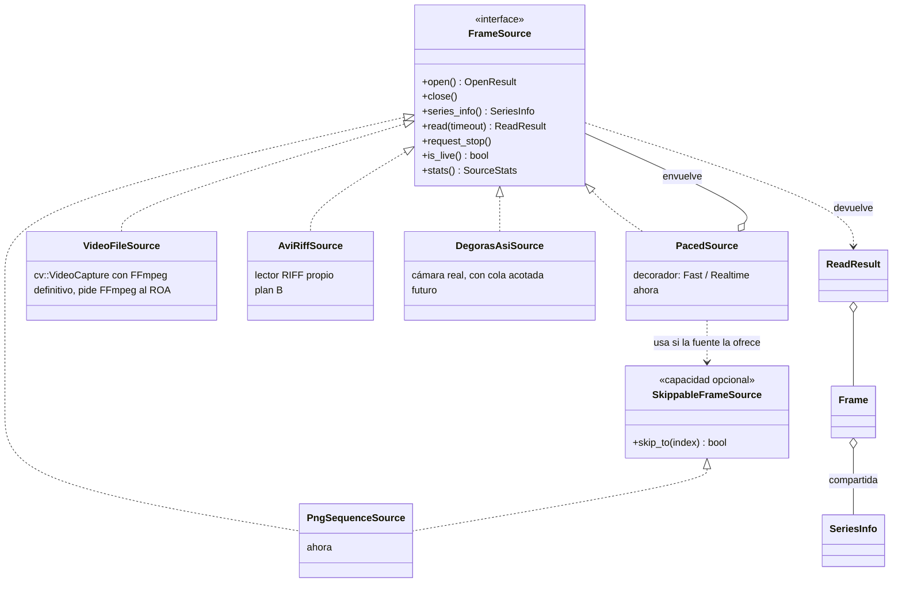
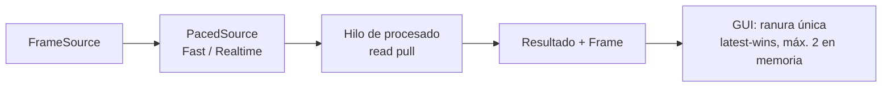

# Contrato de la interfaz de fuente de fotogramas (`frame_source`)

**Estado:** borrador para revisión · **Autor del diseño:** Juan (equipo de imagen y apuntado) · **Revisores:** Javi y Ramón
**Issue:** «Contrato de la interfaz de fuente de fotogramas» (`docs/plan-issues.md` §1), milestone *Fase 1 – Contratos*.
**Requisitos que cubre:** `docs/contexto_proyecto.md` §5 (Entrada: la arquitectura debe permitir DegorasASI) y §8.1.
**Redacción:** el borrador lo ha redactado la IA a partir de las decisiones de Juan. Es el autor quien revisa y decide.

## Cómo leer este documento

Cada decisión lleva una etiqueta:

- **[Decidido]**: lo ha decidido Juan de forma explícita.
- **SUPUESTO**: depende de algo no confirmado por el ROA o no comprobado en el entorno. Se resuelve con la pregunta o la prueba indicada.

Todo el pseudocódigo es C++20 sin implementación y no se ha compilado. Los nombres son provisionales.

---

## 1. Propósito y responsabilidades

`frame_source` entrega al resto del sistema una secuencia de fotogramas con su marca de tiempo y los metadatos de la cámara que los capturó, sin que el núcleo sepa de dónde vienen: una secuencia de PNG, un vídeo o, más adelante, la cámara real a través de DegorasASI (§5, §8.1).

**Responsabilidades de la fuente**

1. Entregar el fotograma **en bruto**, tal como lo capturó la cámara, con su índice, su hora (estimada o medida) y su calidad.
2. Describir la serie (`SeriesInfo`): cámara, tamaño, formato de píxel, ajustes de captura, volteo, origen del recorte.
3. Informar de la **fase del patrón Bayer** ya corregida por el origen del recorte **[Decidido]**.
4. Comunicar el fin de la fuente, los fotogramas ilegibles y los fallos **sin lanzar excepciones**.

**Lo que la fuente NO hace**

- No aplica debayer, volteo, recorte, reducción de resolución ni conversión de tipo **[Decidido]**. Eso es del preprocesado del núcleo.
- No conoce la geometría de la cámara (escala, giro, punto de referencia): eso es de `calibration`.
- No detecta saturación ni inestabilidad: informa del `white_level` y el núcleo decide.
- No controla la cámara (exposición, ganancia): solo lee **[Decidido]**; a confirmar con el ROA (pregunta 7).
- No gestiona la señal de montura en tránsito: es otro módulo (`mount_signal`, §5).

**Por qué no depende de Qt.** `libs/frame_source` solo usa la biblioteca estándar y OpenCV; Qt queda en `apps/gui` (`CLAUDE.md`, restricciones técnicas). Así la CLI y los tests usan la misma fuente que la GUI, y el código es portable a Linux.

---

## 2. Estructura del fotograma

### 2.1 Tipos auxiliares

```cpp
// Fase del mosaico en el píxel (0,0) de la imagen ENTREGADA, o Mono.
enum class PixelFormat { Mono, BayerRGGB, BayerGRBG, BayerGBRG, BayerBGGR };

enum class FlipMode { None, Horizontal, Vertical, Both };   // "Flip = Horizon" -> Horizontal

enum class TimeQuality {
    Measured,    // hora tomada de la cámara/driver por fotograma (futuro DegorasASI)
    Estimated,   // calculada a partir de la serie (inicio, periodo...)
    Unknown      // no hay hora utilizable; solo hay índice
};

struct FrameTime {
    std::optional<std::chrono::system_clock::time_point> utc;   // vacío si quality == Unknown
    std::chrono::nanoseconds uncertainty{};                     // semiancho: la hora real está en utc ± uncertainty
    TimeQuality quality = TimeQuality::Unknown;
    std::optional<std::chrono::nanoseconds> since_series_start; // vacío si no hay periodo
};
```

### 2.2 `Frame`

```cpp
struct Frame {
    std::uint64_t index;                      // PNG: NNNN del fichero − primer NNNN de la serie (0, 1, 2...); un hueco en NNNN es un hueco en index
    cv::Mat image;                            // 1 canal, CV_8UC1 (RAW8 ahora) o CV_16UC1 (RAW16 después); en bruto
    PixelFormat pixel_format;                 // Mono, o fase Bayer en (0,0) de `image`, ya corregida por el recorte
    int bits_per_sample;                      // bits válidos por muestra (8 ahora)
    std::uint32_t white_level;                // valor de saturación en unidades de `image` (cuentas digitales)
    FrameTime time;
    std::shared_ptr<const SeriesInfo> series; // metadatos compartidos de la serie
};
```

| Campo | Tipo | Unidad / significado | Etiqueta |
|---|---|---|---|
| `index` | `uint64_t` | Con secuencias PNG: `NNNN` del fichero menos el primer `NNNN` de la serie, desde 0 y monótono; los huecos de numeración se ven como huecos de `index`. En otras fuentes, posición en la serie. Los fotogramas perdidos conservan su índice. | [Decidido] (PNG); [Decidido] (otras fuentes) |
| `image` | `cv::Mat` | Cuentas digitales (ADU). 1 canal. Dimensiones = `series->width × height`. Filas crecientes hacia abajo (la fila crece hacia −El, §2). | [Decidido] (tipo en bruto) |
| `pixel_format` | enum | Fase del patrón en el píxel (0,0) entregado. | [Decidido] (fase corregida) |
| `bits_per_sample` | `int` | Bits válidos; 8 con RAW8. | [Decidido] |
| `white_level` | `uint32_t` | Valor a partir del cual un píxel está saturado. **No se asume `2^bits − 1`**. Con RAW8, 255. | [Decidido] |
| `time` | `FrameTime` | Ver §2.3. | [Decidido] (calidad e incertidumbre viajan con el dato) |
| `series` | `shared_ptr<const SeriesInfo>` | Un solo objeto por serie, compartido. | [Decidido] (D4) |

**Profundidad de bits y `white_level` [Decidido].** La imagen se entrega en su tipo de almacenamiento y la fuente informa de `bits_per_sample` y de `white_level`. El núcleo usa `white_level` para detectar saturación (§2).
SUPUESTO: con RAW16 de ZWO, los datos pueden venir alineados a la izquierda. Si es así, `white_level` no sería `2^bits − 1` y los valores serían múltiplos de `2^(16 − bits)`. No hay material RAW16 todavía, así que se revisa cuando lo haya.

**Fase Bayer corregida [Decidido].** `SeriesInfo::sensor_pattern` es el patrón en el origen del sensor. `Frame::pixel_format` es el patrón en el píxel (0,0) de la imagen recortada. Con el patrón RGGB en el sensor:

| `StartX` | `StartY` | `pixel_format` |
|---|---|---|
| par | par | `BayerRGGB` |
| impar | par | `BayerGRBG` |
| par | impar | `BayerGBRG` |
| impar | impar | `BayerBGGR` |

**`pixel_format` NO está validado para la ASI585MC [Decidido].** Hay dos incógnitas:

1. El patrón RGGB del sensor no está confirmado (§2, §9; pregunta 3).
2. El volteo horizontal (Flip = Horizon) puede cambiar la fase. Si ASICap lo aplica **antes de guardar** la imagen, con un ancho par la fase cambia (RGGB → GRBG): al invertir cada fila, la que empezaba por «R G» pasa a empezar por «G R». Si lo aplica el sensor o el SDK de otra forma, el resultado puede ser distinto.

Hasta saberlo, la fuente **no** corrige por el volteo y lo informa en `SeriesInfo::acquisition_flip`. La tabla anterior solo corrige por el origen del recorte. Se comprobará con una **prueba propia con un PNG real** (apartado 8): comparar la estadística de los 4 subplanos 2×2 en cielo de fondo; los dos verdes deben coincidir, lo que identifica su diagonal.

### 2.3 Marca de tiempo [Decidido: calidad e incertidumbre viajan con el dato]

No hay hora por fotograma (Timestamp Frames = OFF, §3). La fuente estima la hora y lo declara en `quality`. Para la salida de la aplicación basta el tiempo relativo; la precisión importará al cruzar con el registro de posiciones de la montura (§3).

Reglas de estimación **[Decidido]** (aplican por disponibilidad de datos en `SeriesInfo`, no por tipo de fichero):

1. **Si hay `start_capture`, `end_capture` y `frame_count > 1`** (caso de los AVI: solo el `.txt` del vídeo trae estas claves; el de la serie PNG no, §3.1):
   `t_i = start_capture + i · (end_capture − start_capture) / (frame_count − 1)`.
   Con los datos del ejemplo de §3 (226 fotogramas, 19:16:31,237 → 19:17:35,494) sale un periodo de 0,2856 s, que coincide con los ~0,286 s esperados. Calidad `Estimated`. La incertidumbre inicial es un periodo, y se refinará con un experimento (SUPUESTO: el periodo es uniforme; hay jitter por la lectura USB).
2. **Si no hay inicio y fin, pero hay hora en el nombre del fichero y un periodo configurado**: el nombre `AAAA-MM-DD-HHMM_d-…` da la hora `t0` en décimas de minuto, es decir, con resolución de 6 s. SUPUESTO: no se sabe si el nombre **trunca** o **redondea** las décimas de minuto. Con truncado, la hora real está en `[t0, t0 + 6 s)`; con redondeo, en `[t0 − 3 s, t0 + 3 s)`. Hasta confirmarlo se cubren los dos casos: `t_i = (t0 + 1,5 s) + i · periodo` con semiancho **±4,5 s** (la unión `[t0 − 3 s, t0 + 6 s)`). Calidad `Estimated` **[Decidido]**.
   Evidencia disponible: `1916_5` (= 19:16:30) frente a `StartCapture = 19:16:31,237` en el `.txt` real del AVI es coherente con los dos casos: 31,237 s son 5,2 décimas de minuto y tanto truncar como redondear dan 5. Discriminaría una serie con la fracción de la décima ≥ 0,5 (con `StartCapture` a 19:16:34 s, truncar da 5 y redondear da 6). Una vez confirmado, la estimación se estrecha a `t0 + 3 s ± 3 s` (truncado) o a `t0 ± 3 s` (redondeo) (§10).
   **El periodo debe configurarse; no hay valor por defecto [Decidido].** El `.txt` de las series PNG no lo trae, y ni siquiera se usa el ~0,286 s del AVI de ejemplo: depende de la exposición, del recorte y del USB. Sin periodo configurado se aplica la regla 3, y `Realtime` sobre una serie PNG falla en `open()` (§4).
3. **Si no hay periodo**: calidad `Unknown`, `utc` vacío, solo `index`.

**Qué precisión hace falta.** Para la salida solo importa `cos(El)` (para pasar de dAz·cos(El) a dAz, §2): unos segundos de error en la hora cambian la elevación una fracción de grado como máximo y `cos(El)` en una parte entre miles, así que son despreciables. Lo que **no sirve** es usar esta hora para **predecir la posición de la estrella en la imagen** (calcularla con el catálogo, la hora y las coordenadas de la estación, §3). La rotación sidérea es de hasta 15″/s: ±4,5 s son unos 68″, que a 0,0758″/px son del orden de 900 px en la ASI585MC. Para eso haría falta `Measured` o el registro de la montura.

**Zona horaria [Decidido].** La hora es UTC (`std::chrono::system_clock`). Si el `.txt` indica `TimeZone ≠ 0`, se **aplica el desfase** y se añade un aviso en `OpenResult::warnings`; `open()` no falla. Con los `.txt` reales, `TimeZone = 0` **[Decidido]**, pero la clave solo aparece en el `.txt` del AVI: las series PNG no la traen y se asume UTC **[Decidido]**. SUPUESTO: no se ha visto `TimeZone ≠ 0`, así que no se sabe el signo del desfase ni a qué horas afecta. Decidido: aplicarlo solo a las horas sin designador explícito de UTC (en el ejemplo de §3, `StartCapture` lleva `Z`, luego ya es UTC), para no aplicarlo dos veces. Se verifica cuando aparezca un caso real.

---

## 3. Metadatos de serie

```cpp
struct SeriesInfo {
    std::string source_name;                  // ruta o identificador, para los logs
    std::string camera_id;                    // clave para buscar la calibración de la cámara
    int width, height;                        // píxeles de la imagen entregada
    PixelFormat sensor_pattern;               // Mono, o patrón en el origen del sensor (SUPUESTO RGGB en la 585MC)
    int roi_start_x, roi_start_y;             // origen del recorte en el sensor (StartX / StartY del .txt)
    int bin;                                  // 1 (todo el material está en Bin 1, §2)
    FlipMode acquisition_flip;                // "Flip" del .txt; la fuente no lo aplica
    double exposure_s;                        // segundos (el .txt trae milisegundos)
    double gain;                              // unidades de ASICap (no son dB); POR SERIE, no por fotograma
    std::optional<double> sensor_temp_c;      // °C
    std::optional<int> black_level;           // de "Brightness"; SUPUESTO: unidades en RAW8 sin confirmar (ver abajo)
    std::optional<std::string> output_format; // de "Output Format = *.AVI" -> "AVI"; vacío si el .txt no lo trae
    std::optional<std::uint64_t> frame_count; // vacío en directo
    std::optional<std::chrono::system_clock::time_point> start_capture, end_capture;
    std::optional<std::chrono::nanoseconds> frame_period;   // calculado o configurado
    bool is_live;
};
```

**Asociación con el fotograma y con la calibración [Decidido, D4].** Los metadatos están en un único objeto inmutable, compartido por todos los fotogramas de la serie con `shared_ptr<const SeriesInfo>`. No se copian en cada fotograma.

`SeriesInfo` describe **cómo se capturó** la imagen. La **geometría** (escala, giro, ejes, punto de referencia) vive en `calibration` y se enlaza por `camera_id`. Esta separación permite que DegorasASI rellene `SeriesInfo` sin `.txt`. El núcleo comprueba que ambos casan (tamaño, volteo esperado, recorte) y lo avisa si no, **[Decidido]**.

Correspondencia con el `.txt` de ASICap (formato completo en §3.1):

| Campo del `.txt` | Campo de `SeriesInfo` |
|---|---|
| Cabecera `[ZWO ASI2600MM Pro]` | `camera_id` (tabla modelo → `camera_id`, §3.1) |
| Exposure (`100ms`) | `exposure_s` |
| Gain (`606`) | `gain` |
| Bin (`1`) | `bin` |
| Capture Area Size (`6248 * 4176`), StartX/StartY | `width`, `height`, `roi_start_x`, `roi_start_y` |
| Colour Format (`RAW8`), Debayer Type (`NONE`) | tipo de `Frame::image`, `bits_per_sample`, `pixel_format` |
| Temperature (`-0.5 C`) | `sensor_temp_c` |
| Brightness (`1`) | `black_level` |
| Flip (`Horizon`) | `acquisition_flip = Horizontal` |
| Output Format (`*.AVI`, solo en el `.txt` del vídeo) | `output_format = "AVI"` |
| StartCapture / EndCapture / FrameCount / TimeZone (solo AVI) | `start_capture`, `end_capture`, `frame_count`; `TimeZone` según §2.3 |

**Ganancia y ajustes por serie [Decidido].** `gain`, `exposure_s`, `sensor_temp_c` y `black_level` describen la **serie**, no cada fotograma. Los dos `.txt` reales lo muestran: la ganancia es 606 en la serie PNG y 500 en el AVI, y la temperatura es −0,5 °C y −0,7 °C. El núcleo no debe suponer una ganancia fija entre series. SUPUESTO: la autoexposición no está activa (el `.txt` solo trae sus límites, `Auto Exp Max Exp`, `Auto Exp Max Gain` y `Auto Exp Target Brightness`; según el resumen del contexto no se usa), de modo que exposición y ganancia son constantes dentro de la serie.

**`black_level` y `output_format` [Decidido].** `black_level` sale de `Brightness`. SUPUESTO: no se sabe en qué unidades está en RAW8 (puede ser un desplazamiento del sensor y no cuentas digitales). Hasta comprobarlo con fotogramas oscuros, el núcleo **no** debe restarlo como nivel de negro **[Decidido]**. `output_format` sale de `Output Format = *.AVI` (sin el `*.`). El `.txt` de la serie PNG no trae esa clave: queda vacío, y `PngSequenceSource` lo rellena con `"PNG"` **[Decidido]**.

**Identificación de la cámara [Decidido].** El `.txt` identifica la cámara por su **cabecera `[modelo]`**, y una tabla modelo → `camera_id` (§3.1) da el `camera_id`. Además hay un respaldo por tamaño de imagen con el sensor completo:

| Tamaño de imagen | `camera_id` |
|---|---|
| 6248 × 4176 | `ASI2600MM` |
| 3840 × 2160 | `ASI585MC` |

Si el tamaño no coincide con ninguno (por ejemplo, un recorte), `camera_id` **se exige en la configuración** y, si falta, `open()` falla con un mensaje claro. Orden de prioridad **[Decidido]**: la configuración explícita, luego la cabecera `[modelo]` del `.txt`, luego el respaldo por tamaño.

**Comprobación cruzada [Decidido].** Si el `camera_id` elegido (por configuración o por el `.txt`) no casa con el de la tabla para el tamaño de imagen de sensor completo, `open()` **abre y avisa** en `OpenResult::warnings`. Ejemplo: `camera_id = ASI585MC` con una imagen de 6248 × 4176. El riesgo es usar la calibración de la otra cámara: las escalas son 1,932″/px y 0,0758″/px, un factor de unos 25 (§2), y el desvío en arcsec saldría ×25 mal. El aviso debe mostrarse al operador. **Con recorte [Decidido].** Si el tamaño no es el de un sensor completo, se comprueba que el recorte cabe en el sensor de la cámara elegida: `roi_start_x + width ≤ ancho del sensor` y `roi_start_y + height ≤ alto del sensor` (sensores de la tabla: 6248 × 4176 en la `ASI2600MM`, 3840 × 2160 en la `ASI585MC`). Si no cabe, `open()` abre y avisa en `warnings`, con el mismo riesgo de calibración equivocada (×25). La misma comprobación detecta una imagen de tamaño completo con `StartX`/`StartY` distintos de 0. Si el `camera_id` no figura en la tabla, la comprobación no es posible y no se avisa **[Decidido]**. Si el `camera_id` de la configuración difiere del que da la cabecera `[modelo]`, también se avisa en `warnings`, por el mismo riesgo ×25 **[Decidido]**.

**Sensor completo [Decidido].** En los dos `.txt` reales de la ASI2600MM, `Capture Area Size = 6248 * 4176` y `StartX = StartY = 0`: son series de sensor completo. Si un `.txt` trajera un recorte, `StartX/StartY` desplazaría el punto de referencia respecto al que supone la calibración, y las comprobaciones de arriba lo avisan. SUPUESTO: no hay todavía un `.txt` real de la ASI585MC, así que para ella el sensor completo sigue sin comprobarse.

### 3.1 Formato del `.txt` de ASICap

Formato observado en los dos ficheros reales de la ASI2600MM, copiados en `tests/data/asicap/` (`asi2600mm_serie_png.txt` y `asi2600mm_serie_avi.txt`).

**Estructura [Decidido].**
- La primera línea es una **cabecera** `[modelo]`, por ejemplo `[ZWO ASI2600MM Pro]`.
- Después, una línea por ajuste con la forma `Clave = Valor`. La clave puede llevar espacios (`Capture Area Size`).
- Las **unidades van dentro del valor**: `100ms`, `30000ms`, `-0.5 C`, `6248 * 4176` (ancho `*` alto), `*.AVI`, `2026-10-28T19:16:31.237Z`, `No Limit`, `ON`/`OFF`.
- Las claves **desconocidas se ignoran sin fallar**.
- La serie PNG trae menos claves que el vídeo: el `.txt` del AVI añade `Output Format`, `StartCapture`, `EndCapture`, `TimeZone`, `FrameCount` y `Capture Limit`.

**Claves [Decidido]** (el reparto entre obligatorias y opcionales lo propuso la IA y lo ha aceptado Juan):

| Clave | Ejemplo | Uso | Estado |
|---|---|---|---|
| Cabecera `[modelo]` | `ZWO ASI2600MM Pro` | `camera_id` | Obligatoria, salvo que `camera_id` venga de la configuración |
| `Exposure` | `100ms` | `exposure_s` | Obligatoria |
| `Gain` | `606` | `gain` | Obligatoria |
| `Bin` | `1` | `bin` | Obligatoria |
| `Capture Area Size` | `6248 * 4176` | `width`, `height` | Obligatoria |
| `Colour Format` | `RAW8` | tipo, `bits_per_sample` | Obligatoria |
| `StartX`, `StartY` | `0` | `roi_start_x`, `roi_start_y` | Obligatoria |
| `Flip` | `Horizon` | `acquisition_flip` | Obligatoria |
| `Debayer Type` | `NONE` | comprobación | Opcional: si no es `NONE`, aviso |
| `Temperature` | `-0.5 C` | `sensor_temp_c` | Opcional |
| `Brightness` | `1` | `black_level` | Opcional |
| `Timestamp Frames` | `OFF` | comprobación | Opcional: si es `ON`, aviso (no está soportado; ver la nota de debajo) |
| `Output Format` | `*.AVI` | `output_format` | Opcional (solo vídeo) |
| `StartCapture`, `EndCapture`, `FrameCount` | `2026-10-28T19:16:31.237Z`, `226` | §2.3 regla 1 | Opcional (solo vídeo) |
| `TimeZone` | `0` | §2.3 | Opcional (solo vídeo) |
| `Auto Exp Max Exp`, `Auto Exp Max Gain`, `Auto Exp Target Brightness`, `Hardware Bin`, `High Speed Mode`, `USB Limit`, `USB Port`, `Capture Limit` | — | sin uso | Conocidas e ignoradas |

**`Timestamp Frames = ON` [Decidido].** Hay que comprobar si ASICap dibuja la hora sobre la imagen. Si lo hace, esos píxeles quedan contaminados y no son datos del cielo. Todo el material actual trae `OFF`, así que no afecta hoy, pero la fuente avisa si encuentra `ON`.

**Lectura de valores [Decidido].**
- Unidades de tiempo aceptadas: `us`, `ms`, `s`. Temperatura: `C`. Tamaño: `ancho * alto`. Marca de tiempo: ISO 8601 con milisegundos y `Z`.
- Un valor ilegible en una clave **obligatoria** hace fallar `open()` con un mensaje que nombra la clave. Si faltan claves obligatorias, el mensaje las lista todas.
- Un valor ilegible en una clave **opcional** se ignora y deja un aviso en `warnings`.
- Una clave repetida: gana la última, con aviso.
- Se aceptan finales de línea CRLF y LF, y se recortan los espacios alrededor de claves y valores. SUPUESTO: la codificación es ASCII o UTF-8.
- Las claves desconocidas no generan aviso; solo se anotan en el log de depuración **[Decidido]**.

**Tabla modelo → `camera_id`.** La cabecera se compara con la tabla **ignorando los espacios sobrantes al principio y al final** del nombre del modelo (dentro de los corchetes) y de la línea de cabecera; por lo demás, la comparación es exacta (distingue mayúsculas de minúsculas) **[Decidido]**.

| Cabecera `[modelo]` | `camera_id` | Sensor completo | Estado |
|---|---|---|---|
| `ZWO ASI2600MM Pro` | `ASI2600MM` | 6248 × 4176 | Visto en los `.txt` reales |
| `ZWO ASI585MC Pro` | `ASI585MC` | 3840 × 2160 | SUPUESTO: no hay `.txt` real de la 585MC; el texto se deduce por analogía |

Si la cabecera no está en la tabla, `open()` no falla: avisa en `warnings` y usa el `camera_id` de la configuración o el respaldo por tamaño **[Decidido]**.

---

## 4. Interfaz

Solo pull en esta fase **[Decidido]**: el hilo de procesado llama a `read()`. La GUI nunca lee de la fuente; recibe resultados.

```cpp
enum class ReadStatus {
    Ok,           // `frame` válido
    EndOfSource,  // no hay más fotogramas (o se pidió parar); definitivo e idempotente
    Corrupt,      // este fotograma no se pudo leer; el siguiente read() continúa
    Timeout,      // solo en directo: no llegó fotograma a tiempo; se puede reintentar
    Fatal         // la fuente ya no es utilizable (fichero desaparecido, cámara desconectada)
};

struct ReadResult {
    ReadStatus status;
    std::shared_ptr<const Frame> frame;   // no nulo solo si status == Ok
    std::uint64_t index;                  // índice al que se refiere (incluido en Corrupt)
    std::string message;                  // diagnóstico legible; vacío en Ok
};

struct OpenResult {
    bool ok;
    std::string message;                  // motivo si !ok
    std::vector<std::string> warnings;    // p. ej. ficheros ignorados
};

struct SourceStats {
    std::uint64_t delivered, corrupt, dropped;   // dropped: saltados por PacedSource en Realtime (0 en Fast)
    std::uint64_t dropped_decoded;               // de los dropped, los que hubo que decodificar porque la fuente no tiene skip_to
};

class FrameSource {
public:
    virtual ~FrameSource() = default;

    virtual OpenResult open() noexcept = 0;
    virtual void close() noexcept = 0;

    // Válida tras un open() correcto.
    virtual std::shared_ptr<const SeriesInfo> series_info() const noexcept = 0;

    // Un solo consumidor. Ficheros: nunca devuelve Timeout y el timeout se ignora.
    virtual ReadResult read(std::chrono::milliseconds timeout) noexcept = 0;

    // Seguro desde cualquier hilo; despierta un read() bloqueado, que devuelve EndOfSource.
    virtual void request_stop() noexcept = 0;

    virtual bool is_live() const noexcept = 0;
    virtual SourceStats stats() const noexcept = 0;

    // Capacidad opcional: nullptr si la fuente no sabe saltar sin decodificar.
    virtual SkippableFrameSource* skipper() noexcept { return nullptr; }
};

// Capacidad opcional [Decidido, D9]: saltar hacia delante sin decodificar los fotogramas intermedios.
class SkippableFrameSource {
public:
    virtual ~SkippableFrameSource() = default;
    // Hace que el siguiente read() entregue `index` (o el estado que le corresponda a ese índice).
    // Solo hacia delante: devuelve false, sin cambiar nada, si index < siguiente índice.
    // Si index pasa del final, el siguiente read() devuelve EndOfSource.
    virtual bool skip_to(std::uint64_t index) noexcept = 0;
};
```

**Qué se ha decidido.** Pull, resultado por estructura sin excepciones y C++20 son **[Decidido]** (D5, D6). Los nombres, los cinco estados de `ReadStatus`, `warnings`, `SourceStats` y `request_stop()` son **[Decidido]**. `request_stop()`, `is_live()`, el contador `dropped`, `Timeout` y `Fatal` salen de la lista de requisitos para DegorasASI (D13, aceptada). El contador `dropped` lo suma `PacedSource` en `Realtime`, no la fuente.

**Cómo encaja DegorasASI sin cambiar la interfaz [Decidido, D13].** Hace falta: (1) `SeriesInfo` con campos opcionales; (2) `TimeQuality::Measured` y `frame_count` vacío en directo; (3) `request_stop()`; (4) contador de descartados; (5) `read(timeout)` con `Timeout` y `Fatal`; (6) fuente solo de lectura. El **adaptador con cola acotada** (para un SDK que entregue por callback) **se diseña al integrar DegorasASI**, no en esta fase **[Decidido]**.

**Salto hacia delante (`skip_to`) [Decidido, D9].** Sustituye al `seek` genérico del borrador anterior. Es una capacidad **opcional** (`SkippableFrameSource`, arriba) que solo avanza y no decodifica los fotogramas saltados. `PngSequenceSource` la implementa ya (§6.1). Las fuentes que no pueden (por ejemplo, la cámara) devuelven `nullptr` en `skipper()`. Un `seek` hacia atrás o aleatorio no se implementa hasta que un experimento lo pida. Los detalles de la firma (`skipper()` como método virtual con valor por defecto, y no un `dynamic_cast`) son **[Decidido]**.

**Decorador de ritmo [Decidido, D8 (c)].**

```cpp
enum class PaceMode { Fast, Realtime };

// Reloj inyectable: en producción envuelve a steady_clock; en los tests es un reloj controlado.
class Clock {
public:
    virtual ~Clock() = default;
    virtual std::chrono::steady_clock::time_point now() const = 0;
    virtual void sleep_until(std::chrono::steady_clock::time_point t) = 0;  // debe poder despertarse con request_stop()
};

// Envuelve una fuente y fija el ritmo y la política de descarte fuera de ella.
class PacedSource final : public FrameSource {
public:
    PacedSource(std::unique_ptr<FrameSource> inner, PaceMode mode,
                double speed_factor = 1.0, std::shared_ptr<Clock> clock = nullptr /* reloj real */);
    // ... mismos métodos que FrameSource; stats().dropped suma los fotogramas saltados
};
```

**La política de descarte depende del modo de ritmo, no de la fuente [Decidido].**

- **`Fast`: nunca descarta.** Entrega todos los fotogramas, lo más rápido posible, uno tras otro. Es el modo de la CLI, los tests y los experimentos, para que sean reproducibles.
- **`Realtime(speed_factor)`: descarta intermedios**, tanto con la cámara como con el simulador de ficheros. `read()` entrega el fotograma **cuya hora de reproducción corresponde al instante actual**, salta los anteriores y los suma a `dropped`.

Definición de `Realtime` **[Decidido]**, con el reloj inyectable:

- La hora de reproducción del fotograma de índice `i` es `ancla + i · periodo / speed_factor`. El **ancla** es el instante de la primera llamada a `read()`, y el `periodo` sale de `SeriesInfo::frame_period` (~3,5 fps en la RASA, §3).
- Si el fotograma siguiente aún no ha llegado a su hora, `read()` espera con `Clock::sleep_until`. Si la espera supera el `timeout`, devuelve `Timeout`.
- Si el reloj ya ha pasado la hora de varios fotogramas, `read()` entrega el que corresponde al instante actual y suma al contador `dropped` los que se ha saltado. El `index` del fotograma entregado refleja el salto.
- Si la serie no tiene periodo, `open()` falla con un mensaje claro y no cae en silencio a `Fast` **[Decidido]**.
- **Series PNG: `Realtime` exige un periodo configurado, sin valor por defecto [Decidido].** El `.txt` de una serie PNG no trae `StartCapture`, `EndCapture` ni `FrameCount` (§3.1), así que el periodo solo puede venir de la configuración de `PngSequenceSource`.
- Con una fuente en vivo, el «fotograma cuya hora corresponde al instante actual» es el más reciente disponible. La cola y su capacidad se diseñan al integrar DegorasASI **[Decidido]**; la política es la de aquí.

**Cómo salta `PacedSource` [Decidido].** Para saltar al fotograma `k`:
- Si la fuente ofrece `skipper()`, llama a `skip_to(k)`: **los fotogramas saltados no se decodifican**.
- Si no, lee y descarta los intermedios, es decir, los **decodifica**. Lo anota en `SourceStats::dropped_decoded` y en el log **[Decidido]** .

Consecuencias que conviene tener presentes **[Decidido]**:
- Con una fuente sin `skip_to`, saltar obliga a decodificar. Con PNG de 26 MP la decodificación puede superar el periodo y provocar descartes continuos; la medida de §8 lo cuantifica.
- **La corrupción de los fotogramas saltados no se detecta [Decidido].** Un fotograma saltado con `skip_to` no se valida: si estaba corrupto, no se detecta y cuenta como descartado, no como `Corrupt`. En cambio, **en `Fast` no se salta nada y todos los fotogramas se validan**, así que los experimentos ven toda la corrupción.

---

## 5. Comportamiento ante errores y fin de fuente

Ningún método de la interfaz lanza. Dentro de cada fuente, las llamadas a OpenCV o a la biblioteca estándar que puedan lanzar se envuelven en `try/catch` y se traducen a un estado **[Decidido, D6]**.

| Situación | Estado | Qué hace el núcleo |
|---|---|---|
| Fotograma correcto | `Ok` | Lo procesa |
| PNG ilegible, truncado, de otro tamaño o con canales distintos de 1 | `Corrupt` con su `index` y sin imagen | Lo trata como fotograma perdido: la máquina de estados decide (§5, §6); no cierra |
| Hueco en la numeración `NNNN` | `Corrupt` por cada índice que falta | Igual que el anterior; no se salta en silencio **[Decidido, D12]** |
| Se acabaron los fotogramas | `EndOfSource` | Termina la serie. Un `read()` posterior devuelve lo mismo |
| `request_stop()` | `EndOfSource` con `message` | Termina |
| Directo sin fotograma a tiempo | `Timeout` | Reintenta; es el operador quien ve el estado «sin imagen» |
| `Realtime` con retraso de varios fotogramas | `Ok` con el fotograma actual; los saltados suman a `dropped` |
| Fichero desaparecido, cámara desconectada, sin memoria | `Fatal` | Informa y requiere `close()`/`open()` |
| `read()` sin `open()` previo | `Fatal` | — |

Un `Corrupt` **no** se convierte en `Fatal` por acumulación: la decisión de rendirse es del llamante (por ejemplo, con `SourceStats`) **[Decidido]**.

**Fotogramas retenidos y descarte [Decidido; decisión de Juan].**
La GUI retiene solo el último fotograma y su resultado (*latest-wins*). Como máximo hay **2 fotogramas en memoria** por parte de la GUI: el que se muestra y el que acaba de llegar, hasta que se intercambian. Motivo: el operador necesita el estado actual; los experimentos, todos los fotogramas.

- **`Fast`: el procesado nunca descarta**, para que los experimentos sean reproducibles. La lectura por *pull* ya aplica contrapresión, de modo que no se forma cola. Como no se salta nada, todos los fotogramas se validan y toda la corrupción se informa (`Corrupt`). En `Realtime`, en cambio, la corrupción de los fotogramas saltados no se detecta (§4).
- **`Realtime` (cámara o simulador de ficheros): se descartan los intermedios** y se entrega el fotograma que corresponde al instante actual. La política depende del **modo de ritmo**, no de la fuente. Los saltados se cuentan en `SourceStats::dropped` para mostrárselos al operador, y los índices de `Frame` hacen visibles los huecos. Definición exacta en §4.

**Propuestas de la IA sobre esta regla:**
- La capacidad de la cola de la fuente en vivo se concreta al integrar DegorasASI **[Decidido: se diseña entonces]**.
- La trayectoria del overlay (§4, amarillo) debe guardar **coordenadas**, no fotogramas, para no romper el límite de memoria.

---

## 6. Implementaciones previstas





### 6.1 `PngSequenceSource` (ahora)

- Lee una serie `AAAA-MM-DD-HHMM_d-CapObj_NNNN.PNG` (§3), ordenada por el número `NNNN`.
- Lee el `.txt` de la serie para rellenar `SeriesInfo` (§3). Si no hay `.txt`, solo abre si la configuración aporta los campos mínimos; si no, `open()` falla y lista lo que falta **[Decidido]**. El `camera_id` puede deducirse del tamaño de la imagen (§3) **[Decidido]**.
- El índice es `NNNN` menos el primer `NNNN` de la serie **[Decidido]**.
- Lee el `.txt` según el formato de §3.1. Su configuración incluye `camera_id` (opcional), `frame_period` (obligatorio para `Realtime`, sin valor por defecto **[Decidido]**) y rellena `output_format = "PNG"` si el `.txt` no lo trae **[Decidido]**.
- **Implementa `skip_to` desde ya [Decidido].** Al abrir, construye la tabla índice → fichero **solo con los nombres**, sin decodificar. `skip_to(index)` mueve el cursor sobre esa tabla: saltar es avanzar en la lista de ficheros, sin leerlos ni decodificarlos. Si el índice pedido cae en un hueco de numeración, el siguiente `read()` devuelve `Corrupt` para ese índice, como siempre.
- Decodifica con `cv::imread` y `IMREAD_UNCHANGED` **[Decidido, D12 (a)]**. Se comprueba que sea de 1 canal, de tipo 8 o 16 bits y del tamaño de la serie.
- Los ficheros que no siguen el patrón de nombre se ignoran y se anotan en `OpenResult::warnings` **[Decidido]**.
- SUPUESTO: `IMREAD_UNCHANGED` entrega 1 canal sin conversión con un PNG de ASICap; se comprueba con un PNG real. También hay que verificar que `cv::imread` abre rutas con caracteres no ASCII en Windows; si no, se leerán los bytes con `std::ifstream` y se decodificarán con `cv::imdecode`.

### 6.2 AVI

- **Ahora: convertir a PNG [Decidido, D11 (d)].** Un script de Python en `prototypes/python/`, **marcado PRUEBA** (usa `opencv-python`, que trae FFmpeg, §3). Convierte cada AVI a una secuencia PNG y copia al lado el `.txt` con `StartCapture`, `EndCapture` y `FrameCount`, para que la hora estimada siga la regla 1 de §2.3.
- **Definitivo: pedir al ROA que añada FFmpeg a opencv4 [Decidido].** Entonces `VideoFileSource` usa `cv::VideoCapture`. Hay que comprobar con la versión del entorno (OpenCV 4.14) que entrega los valores RAW8 **sin alterar**, antes de darla por buena. Riesgo (SUPUESTO): el backend FFmpeg puede devolver el fotograma en 3 canales o con conversión de rango. Prueba de aceptación: los valores deben ser idénticos, píxel a píxel, a los de la secuencia PNG convertida.
- **Plan B [Decidido]:** lector RIFF propio (`AviRiffSource`), solo si no se consigue FFmpeg. Problema que habría que documentar y resolver: el AVI de ejemplo pesa 5,9 GB, más que un RIFF clásico (2 GB), por lo que probablemente usa OpenDML (extensiones `RIFF AVIX` e índices `ix##`). Además hay que tratar el relleno de filas y el orden de filas del DIB. SUPUESTO: ASICap escribe OpenDML (a verificar con la cabecera real).
- **Descartada: QtMultimedia [Decidido]**, porque obligaría a poner la fuente en `apps/gui` (regla de Qt), dejaría fuera la CLI y los tests, y podría convertir a color los fotogramas (§3).
- **Descartada: `cv::VideoCapture` con la configuración actual**, porque opencv4 se compiló sin FFmpeg (§3, §9). Es la opción definitiva *si* se añade FFmpeg.

### 6.3 `DegorasAsiSource` (futuro)

No se diseña aquí. La interfaz ya admite lo necesario (§4). El adaptador con cola acotada se diseña al integrarla **[Decidido]**; la política de descarte ya está fijada en `PacedSource` `Realtime` (§4). Las preguntas al ROA (pregunta 7) condicionan los detalles.

### 6.4 `MemoryFrameSource` (tests) [Decidido]

Fuente que sirve una lista de fotogramas ya construidos en memoria. Permite probar el núcleo con datos sintéticos de solución conocida sin pasar por disco.

---

## 7. Casos límite

| Caso | Comportamiento |
|---|---|
| Directorio vacío o sin PNG de la serie | `open()` falla con mensaje |
| Hueco o duplicado en `NNNN` | Hueco: `Corrupt` por cada índice que falta. Duplicado: se avisa en `warnings` **[Decidido]** |
| PNG con otro tamaño o de 3 canales | `Corrupt` en un fotograma intermedio; fallo de `open()` si es el primero |
| `StartX`/`StartY` impares | La fase Bayer de `pixel_format` cambia según la tabla de §2.2 |
| Imagen toda negra o toda saturada | La fuente la entrega igual; lo evalúa el núcleo |
| `FrameCount` del `.txt` distinto del número real | Aviso en `warnings` y calidad `Unknown`, porque la fórmula de §2.3 dejaría de valer **[Decidido]** |
| `frame_count == 1` | Periodo indefinido: `t = start_capture` |
| `read()` tras `EndOfSource` | Devuelve `EndOfSource` otra vez |
| `read()` antes de `open()` | `Fatal` |
| `close()` y `open()` de nuevo | Reinicia el índice a 0 |
| `request_stop()` con `read()` bloqueado | Despierta y devuelve `EndOfSource` |
| Un hilo distinto del consumidor llama a `read()` | No soportado: un solo consumidor |
| Memoria: un fotograma de la 2600MM ocupa unos 26 MB | Un AVI de 5,9 GB no se carga entero; se lee fotograma a fotograma |
| Flip de la serie distinto del que espera la calibración | La fuente lo informa; avisa el núcleo, no la fuente |
| `TimeZone ≠ 0` en el `.txt` | Se aplica el desfase y se avisa en `warnings`; no falla **[Decidido]** |
| Tamaño de imagen sin coincidencia con un sensor completo y sin `camera_id` en la configuración | `open()` falla y lo indica **[Decidido]** |
| `camera_id` que no casa con el de la tabla para un tamaño de sensor completo | `open()` abre y avisa en `warnings` (riesgo: calibración equivocada, error ×25) **[Decidido]** |
| Recorte que no cabe en el sensor de la cámara elegida (`StartX + ancho` o `StartY + alto` mayor que el sensor) | `open()` abre y avisa en `warnings` (mismo riesgo ×25) **[Decidido]** |
| `skip_to` hacia atrás (índice menor que el siguiente) | Devuelve `false` y no cambia nada **[Decidido]** |
| `skip_to` más allá del final | El siguiente `read()` devuelve `EndOfSource` **[Decidido]** |
| Serie PNG que empieza en un `NNNN` distinto de 0 | `index` empieza en 0 (`NNNN` − primer `NNNN`) **[Decidido]** |
| `Realtime` sobre una serie PNG sin `frame_period` configurado | `open()` falla y lo indica; no hay valor por defecto **[Decidido]** |
| `.txt` con una clave desconocida | Se ignora sin fallar y sin aviso **[Decidido]** |
| `.txt` sin una clave obligatoria, o con un valor ilegible en una obligatoria | `open()` falla y nombra las claves **[Decidido]** |
| `.txt` con un valor ilegible en una clave opcional | Se ignora y avisa en `warnings` **[Decidido]** |
| `.txt` con una clave repetida | Gana la última y avisa en `warnings` **[Decidido]** |
| `Debayer Type ≠ NONE` o `Timestamp Frames = ON` en el `.txt` | `open()` abre y avisa en `warnings`; con `Timestamp Frames = ON`, hay que comprobar si ASICap dibuja la hora sobre la imagen (esos píxeles quedarían contaminados) **[Decidido]** |
| Cabecera `[modelo]` que no está en la tabla | `open()` abre y avisa; usa la configuración o el tamaño **[Decidido]** |
| Cabecera `[modelo]` con espacios sobrantes al principio o al final | Se ignoran: se comprueba igual contra la tabla **[Decidido]** |
| `.txt` con finales de línea CRLF o LF | Se aceptan los dos |

---

## 8. Cómo se probará

Los tests siguen la regla de `CLAUDE.md`: datos sintéticos de solución conocida y, cuando los haya, recortes reales en `tests/data/`. Se compila con ucrt64 y, si es posible, con clang64.

**Tests unitarios con series sintéticas** (los PNG se generan en un directorio temporal, con el valor de cada píxel función del índice y la posición):

1. **Orden e índice:** los fotogramas salen en orden de `NNNN`, con `index` = `NNNN` − primer `NNNN`. Se prueba con una serie que empieza en `NNNN = 0005`: el primer `index` es 0.
2. **Forma y tipo:** 1 canal, `CV_8UC1`, tamaño de `SeriesInfo`, `white_level` = 255 y `bits_per_sample` = 8. Con un PNG de 16 bits, `CV_16UC1`.
3. **Fase Bayer:** para cada combinación de paridad de `StartX`/`StartY`, `pixel_format` coincide con la tabla de §2.2.
4. **Hora:** con los datos del ejemplo de §3 (226 fotogramas, inicio 19:16:31,237 y fin 19:17:35,494), el fotograma 0 está en el inicio, el 225 en el fin y el periodo es 0,2856 s. Sin periodo, la calidad es `Unknown`. Con solo el nombre del fichero y un periodo configurado, la hora del fotograma 0 es `t0 + 1,5 s` con incertidumbre **±4,5 s** (con `1916_5`, 19:16:31,5 ± 4,5 s, intervalo que contiene el `StartCapture` real, 19:16:31,237). Con `TimeZone ≠ 0` se aplica el desfase y aparece un aviso en `warnings`, sin fallo.
5. **Errores sin excepciones:** un PNG truncado devuelve `Corrupt` y el siguiente `read()` continúa; un hueco devuelve `Corrupt` con el índice; `EndOfSource` es idempotente; `read()` antes de `open()` devuelve `Fatal`. Ningún caso lanza.
6. **`request_stop()`** despierta un `read()` bloqueado desde otro hilo.
7. **`PacedSource`**, siempre con un reloj controlado por el test:
   - `Fast` entrega todos los fotogramas, no espera y `dropped` es 0 aunque el reloj avance mucho entre lecturas.
   - `Realtime`, con el reloj avanzando exactamente un periodo entre lecturas: entrega un fotograma por periodo, sin saltos y con `dropped` = 0.
   - `Realtime`, con el reloj adelantado 3,5 periodos entre dos lecturas: entrega el fotograma que corresponde al instante actual, salta los anteriores y `dropped` suma los saltados; el `index` del fotograma entregado refleja el salto.
   - `Realtime` con `speed_factor` 2 reproduce a doble ritmo.
   - `Realtime` con espera mayor que el `timeout` devuelve `Timeout`.
   - `Realtime` con una serie sin periodo falla en `open()`; en particular, con la serie PNG real (`asi2600mm_serie_png.txt`) y sin `frame_period` configurado, aunque el `.txt` esté completo.
   - `request_stop()` despierta una espera de `Realtime`.
   - Si el salto llega al final de la serie, devuelve `EndOfSource`.
8. **Identificación de la cámara:** 6248 × 4176 da `ASI2600MM`; 3840 × 2160 da `ASI585MC`; otro tamaño sin `camera_id` en la configuración hace fallar `open()`; con `camera_id` en la configuración, abre. **Comprobación cruzada:** `camera_id = ASI585MC` con una serie de 6248 × 4176 abre y deja un aviso en `warnings`, y lo mismo al revés; con un `camera_id` que casa, no hay aviso. **Cabecera del `.txt`:** con `[ZWO ASI2600MM Pro]` y sin `camera_id` en la configuración, se obtiene `ASI2600MM`. **Recorte:** un recorte que cabe (por ejemplo, 1920 × 1080 con `StartX = 100`, `StartY = 50` en la `ASI585MC`) no da aviso; uno que no cabe (por ejemplo, `StartX + ancho` mayor que 3840) da aviso en `warnings`; una imagen de tamaño completo con `StartX ≠ 0` también.
9. **Saltos sin decodificar (`skip_to`):**
    - *Con `PngSequenceSource`*, en `Realtime` con procesado lento (el reloj controlado del test avanza varios periodos entre lecturas): se colocan **PNG deliberadamente corruptos** en los fotogramas que se van a saltar. Si no se decodifican, `stats().corrupt` es 0, el fotograma entregado es el correcto y `dropped` es el número de saltados. Si se decodificaran, aparecerían como `Corrupt`.
    - *Con una fuente de prueba sin `skip_to`* (por ejemplo, `MemoryFrameSource` con `skipper()` en `nullptr`): `PacedSource` lee y descarta los intermedios, `dropped` coincide con los saltados y `dropped_decoded` también.
    - `skip_to` directo: hacia atrás devuelve `false` y no cambia nada; más allá del final da `EndOfSource` en el siguiente `read()`; a un hueco de numeración da `Corrupt` con ese índice.
10. **Parseo del `.txt`**, con los dos ficheros reales de `tests/data/asicap/`:
    - `asi2600mm_serie_png.txt`: `camera_id = ASI2600MM` por la cabecera, sin configuración; `exposure_s = 0,1`; `gain = 606`; `bin = 1`; 6248 × 4176; `roi_start_x = roi_start_y = 0` (sensor completo, sin avisos de recorte); `acquisition_flip = Horizontal`; RAW8 (`CV_8U`, 8 bits); `sensor_temp_c = −0,5`; `black_level = 1`; **sin** `start_capture`, `end_capture` ni `frame_count`; `output_format` vacío (la fuente lo rellena con `"PNG"`); sin avisos.
    - `asi2600mm_serie_avi.txt`: lo mismo, con `gain = 500`, `sensor_temp_c = −0,7`, `output_format = "AVI"`, `start_capture = 2026-10-28T19:16:31,237 Z`, `end_capture = 2026-10-28T19:17:35,494 Z`, `frame_count = 226` y `TimeZone = 0` sin aviso. El periodo derivado es 64,257 s / 225 = 0,28559 s.
    - **La ganancia es por serie:** 606 en una y 500 en la otra.
    - Las claves conocidas sin uso (`Auto Exp Max Exp`, `USB Port`, etc.) no generan avisos ni fallos.
    - Copias modificadas de los dos ficheros (generadas en el test): con una clave desconocida añadida, abre sin fallo ni aviso; sin una clave obligatoria (por ejemplo, `Gain`), `open()` falla y la nombra; con la cabecera `[ZWO ASI585MC Pro]` y 6248 × 4176, abre y avisa de la incoherencia; con espacios sobrantes al principio y al final del nombre del modelo (por ejemplo, `[ ZWO ASI2600MM Pro ]`) o de la línea de cabecera, se obtiene el mismo `camera_id`; con finales de línea CRLF, el resultado es idéntico al de LF.

**Prueba propia con un PNG real de la ASI585MC (fase Bayer) [Decidido].** No es un test unitario: es una comprobación con material real, porque `pixel_format` no está validado (§2.2).

1. Tomar un PNG real de la ASI585MC con cielo de fondo (sin estrellas brillantes en la zona de medida).
2. Separar los 4 subplanos 2×2 (fila par/impar × columna par/impar) y calcular, en una zona de cielo de fondo, su media y su mediana (y la desviación típica, para saber qué diferencia es ruido).
3. **Los dos subplanos verdes deben coincidir** (dentro del ruido). Los dos que coinciden están en una diagonal del bloque 2×2; esa es la diagonal verde:
   - verdes en la diagonal secundaria (posiciones (0,1) y (1,0)): patrón `RGGB` o `BGGR`;
   - verdes en la diagonal principal (posiciones (0,0) y (1,1)): patrón `GRBG` o `GBRG`.
4. Comparar con el patrón esperado (RGGB, verdes en la diagonal secundaria): si el volteo se aplicó antes de guardar y el ancho es par, saldrá `GRBG` (verdes en la diagonal principal).
5. Repetir con una imagen con `StartX`/`StartY` impares, si existe, para comprobar la tabla de §2.2.

Límite de la prueba: identifica la diagonal verde, pero **no distingue rojo de azul** dentro de la otra diagonal. Para eso hace falta una referencia de color (un objeto de color conocido) o la confirmación del ROA (pregunta 3) **[Decidido]**. El resultado se registra en `docs/experimentos/`.

**Aceptación de `VideoFileSource` (cuando haya FFmpeg):** los valores decodificados de un AVI deben ser idénticos, píxel a píxel, a los de la secuencia PNG convertida del mismo AVI.

**Medida para la memoria de I+D** (entrada en `docs/experimentos/`): tiempo de `read()` por fotograma con PNG de 26 MP y de 8 MP (3840 × 2160). Importa en modo en vivo y para estimar el coste de los experimentos; en `Fast` no cuenta para el límite de ~100 ms (§5).

---

## 9. Decisiones tomadas y alternativas descartadas

Pensado para la memoria de I+D.

| # | Decisión | Alternativas descartadas y motivo | Etiqueta |
|---|---|---|---|
| D1 | `cv::Mat` en su tipo de almacenamiento (`CV_8U` o `CV_16U`) más `bits_per_sample` y `white_level`. La fuente informa del `white_level`; no se asume `2^bits − 1`. | *Tipo fijo `uint8`*: impide RAW16 (§3). *Normalizar a `float`*: cuadruplica la memoria de una imagen de 26 MP y oculta el valor de saturación real. | [Decidido] |
| D2 | Entrega en bruto (Mono o mosaico Bayer) con la fase ya corregida por `StartX`/`StartY`. El debayer, la extracción del verde y el superpíxel 2×2 son del preprocesado del núcleo. | *Debayer en la fuente*: pierde el valor original y mezcla el modo estrellas con el haz (§2, §5, §6). | [Decidido] |
| D3 | `FrameTime` con `quality` e incertidumbre. Reglas de estimación de §2.3; con solo el nombre y un periodo configurado (sin valor por defecto), `t0 + 1,5 s ± 4,5 s` (SUPUESTO: el nombre trunca o redondea las décimas de minuto; la estimación cubre los dos casos). `TimeZone ≠ 0`: se aplica el desfase y se avisa. | *Solo índice*: impide cruzar con el registro de montura (§3). *`double` de segundos*: no distingue medido de estimado. *±6 s con `t0`*: sobreestima la incertidumbre. *Fallar con `TimeZone ≠ 0`*: bloquea material utilizable. | [Decidido] (calidad, incertidumbre, ±4,5 s, zona horaria, UTC en series PNG); resto de reglas [Decidido] |
| D4 | `SeriesInfo` inmutable y compartido; geometría separada en `calibration`. `camera_id` por la cabecera `[modelo]` del `.txt` (tabla modelo → `camera_id`), con respaldo por tamaño de imagen (sensor completo); si no casa, se exige en la configuración. | *Copiar todo en cada fotograma*: desperdicio. *Fichero aparte sin enlace*: sin vínculo con el fotograma. *Exigir siempre `camera_id` en la configuración*: más fricción cuando el tamaño ya lo identifica. *Fiarse del `camera_id` sin comprobarlo*: un `camera_id` equivocado da una calibración equivocada, con un error ×25 en arcsec; por eso hay comprobación cruzada con aviso. | [Decidido] |
| — | `index` = `NNNN` − primer `NNNN` de la serie. | *`NNNN` tal cual*: el índice dependería de dónde empezó la numeración de ASICap. | [Decidido] |
| D5 | *Pull* en esta fase. El adaptador con cola para DegorasASI se diseña al integrarla. | *Push con callback*: los tests del núcleo dependerían de la planificación de hilos. | [Decidido] |
| D6 | Resultado por estructura (`ReadResult`), sin excepciones; proyecto en C++20. | *Excepciones*: prohibidas por el requisito de pérdida de blanco sin cierres (§5). *`std::expected`*: descartado a favor de la estructura. | [Decidido] |
| D7 | `shared_ptr<const Frame>`. La GUI retiene como máximo 2 fotogramas. | *Vista sin propiedad*: peligro de datos que se reutilizan. *`cv::Mat` por valor*: no protege los datos compartidos. | [Decidido] |
| D8 | Ritmo y descarte fuera de la fuente (`PacedSource`): `Fast` nunca descarta; `Realtime(factor)` entrega el fotograma de la hora actual y suma los saltados a `dropped`. Reloj inyectable. | *Ritmo dentro de cada fuente*: código duplicado. *Política de descarte ligada a la fuente (fichero o vivo)*: el simulador no reproduciría el comportamiento de la cámara. | [Decidido] |
| D9 | Capacidad opcional `skip_to(index)`, solo hacia delante, en lugar de un `seek` genérico. `PngSequenceSource` la implementa ya (saltar = avanzar en la lista de ficheros, sin decodificar). `PacedSource` `Realtime` la usa si la fuente la ofrece; si no, decodifica y lo anota. | *`seek` genérico (también hacia atrás)*: más complejo y nadie lo necesita todavía. *`seek` obligatorio*: la fuente en vivo no puede implementarlo. *Sin salto*: en `Realtime`, saltar obligaría a decodificar fotogramas de 26 MP que se van a descartar. | [Decidido] |
| D10 | La fuente no transforma píxeles; informa del volteo y la calibración declara el que espera. | *Aplicar el volteo en la fuente*: §5 indica que no hace falta con este material y DegorasASI lo aplicará. | [Decidido] |
| D11 | AVI: convertir a PNG ahora (PRUEBA); definitivo con FFmpeg en opencv4; lector RIFF como plan B. | *QtMultimedia*: viola la regla de Qt y puede convertir a color. *Lector RIFF propio como primera opción*: coste alto por OpenDML. | [Decidido] |
| D12 | `cv::imread` con `IMREAD_UNCHANGED`; los huecos de numeración se informan. | *Lector PNG propio*: sin motivo. | [Decidido] |
| D13 | Requisitos para DegorasASI de §4. | — | [Decidido] |
| — | Regla de descarte: GUI *latest-wins* (máx. 2 en memoria); la política depende del modo de ritmo: `Fast` nunca descarta, `Realtime` descarta intermedios y cuenta. | *Descartar también en `Fast`*: experimentos no reproducibles. *Cola sin límite en la GUI*: memoria sin control. | [Decidido] |
| — | `MemoryFrameSource` para los tests del núcleo. | *Generar PNG temporales para cada test del núcleo*: más lento y más frágil. | [Decidido] |
| — | `pixel_format` sin validar para la 585MC; prueba propia con PNG real (estadística de los 4 subplanos 2×2). | *Dar por buena la fase RGGB*: el volteo puede cambiarla (§2.2). | [Decidido] |
| — | `warnings`, `SourceStats`, `request_stop()`, política de `FrameCount` inconsistente, prioridad entre las fuentes de `camera_id`, `TimeZone` solo a horas sin designador UTC. | — | [Decidido] |
| — | `SeriesInfo` con `black_level` (de `Brightness`) y `output_format`; la ganancia y demás ajustes son por serie. | *Ganancia por fotograma*: el `.txt` es por serie. *Restar `black_level` como nivel de negro*: sus unidades en RAW8 no están confirmadas. | [Decidido] |
| — | Formato del `.txt`: cabecera `[modelo]`, líneas `Clave = Valor` con unidades dentro del valor; claves desconocidas ignoradas sin fallar. | *Fallar con claves desconocidas*: ASICap puede añadir claves en otras versiones. | [Decidido] |
| — | Reparto de claves obligatorias y opcionales, lectura de unidades, claves repetidas, avisos con `Debayer Type` o `Timestamp Frames` (comprobar si ASICap dibuja la hora sobre la imagen), aviso si el `camera_id` de la configuración difiere del de la cabecera, `output_format = "PNG"` en series PNG y UTC en series PNG. | — | [Decidido] |
| — | Fila de la ASI585MC en la tabla modelo → `camera_id` (`ZWO ASI585MC Pro`), deducida por analogía. | *Esperar a un `.txt` real*: bloquearía las pruebas de la 585MC. | SUPUESTO |
| — | Truncado o redondeo de las décimas de minuto del nombre: hasta confirmarlo, `t0 + 1,5 s ± 4,5 s`. | *`t0 + 3 s ± 3 s` (solo truncado)*: el ejemplo real no distingue truncar de redondear. | SUPUESTO |
| — | `black_level` solo informativo (no se resta como nivel de negro); la cabecera `[modelo]` se compara ignorando los espacios sobrantes al principio y al final; cabecera desconocida: se abre y se avisa; claves desconocidas solo en el log de depuración; orden de prioridad de `camera_id` (configuración, cabecera, tamaño). | *Restar `black_level`*: sus unidades en RAW8 no están confirmadas. *Fallar con una cabecera desconocida*: bloquearía una cámara nueva. | [Decidido] |
| — | `Realtime` sobre series PNG exige periodo configurado, sin valor por defecto. | *Periodo por defecto de ~0,286 s*: es el de un AVI concreto; depende de la exposición, del recorte y del USB. | [Decidido] |

---

## 10. Preguntas abiertas

### Para el ROA (Discord)

1. ¿Los AVI de ASICap (los de calibración y los de pasadas) son siempre sin comprimir? ¿Qué `fourcc` usan y están en formato OpenDML (AVI > 2 GB)?
2. **Pedir que añadan FFmpeg a opencv4** en la configuración PoC-proc-video, para que `cv::VideoCapture` abra los AVI. ¿Lo harán, o hay que seguir con la conversión a PNG o con el plan B?
3. ¿El PNG de la ASI585MC es el mosaico Bayer en 1 canal? ¿Se confirma el patrón RGGB? ¿Cambia la fase con un `StartX`/`StartY` impar o con el volteo (Flip = Horizon)?
7. ¿Qué entregará DegorasASI por fotograma (hora de cámara real, índice, descartados)? ¿Entrega por callback o por llamada bloqueante? ¿Quién controla la exposición y la ganancia? ¿Hay reconexión?

(Se mantiene la numeración de la ronda anterior. Las preguntas 4, 5, 6 y 8 se han retirado; ver abajo.)

### Internas (las resolvemos nosotros)

- **Resuelto con los dos `.txt` reales de la ASI2600MM (`tests/data/asicap/`):** el `.txt` identifica la cámara por la cabecera `[modelo]`; las series son de sensor completo; las series PNG no traen `StartCapture`, `EndCapture` ni `FrameCount`; `TimeZone = 0` (solo en el AVI).
- **Pendiente tras esos `.txt`:**
  - Un `.txt` real de la ASI585MC: texto exacto de la cabecera (SUPUESTO: la tabla lo deduce por analogía) y si es de sensor completo.
  - **Truncado o redondeo** de las décimas de minuto del nombre (SUPUESTO): confirmar con otra serie cuyo `StartCapture` tenga la fracción de la décima ≥ 0,5. El ejemplo actual (5,2 décimas) no distingue los dos casos; hasta entonces, la hora se estima como `t0 + 1,5 s ± 4,5 s` (§2.3).
  - Si ASICap dibuja la hora sobre la imagen cuando `Timestamp Frames = ON`: en ese caso esos píxeles quedan contaminados (§3.1).
  - Unidades de `Brightness` en RAW8, con fotogramas oscuros (§3).
  - Si la autoexposición está desactivada en todas las series (§3).
- **Prueba de la fase Bayer con un PNG real de la ASI585MC** (estadística de los 4 subplanos 2×2, §8): decide si ASICap voltea antes de guardar y cuál es la diagonal verde. Sin distinguir rojo de azul, que sigue en la pregunta 3.
- **RAW16:** número de bits válidos y alineación; se aplaza hasta tener material (afecta a D1).
- **Estándar C++:** decidido, C++20.
- **Incertidumbre de la hora en AVI:** el valor inicial (un periodo) se afina con un experimento.
- **Rutas con caracteres no ASCII** con `cv::imread` en Windows, y valores devueltos por `cv::VideoCapture` con FFmpeg (se comprueban al implementar).
- **Signo del desfase de `TimeZone` y a qué horas se aplica** (§2.3): se verifica cuando aparezca un caso real.
